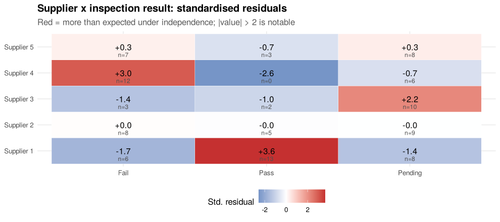
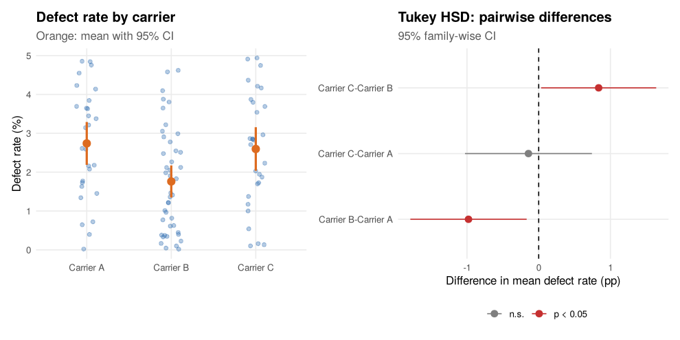
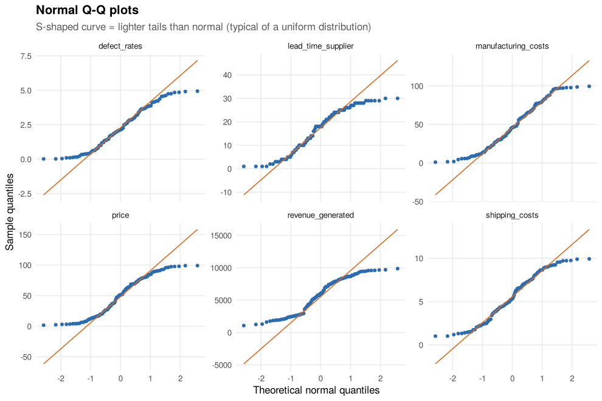
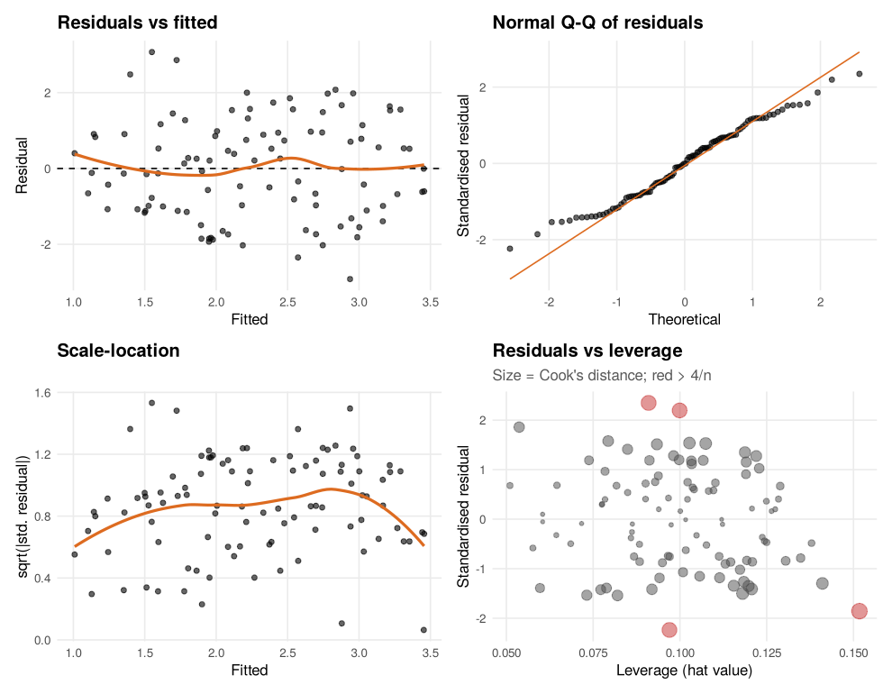
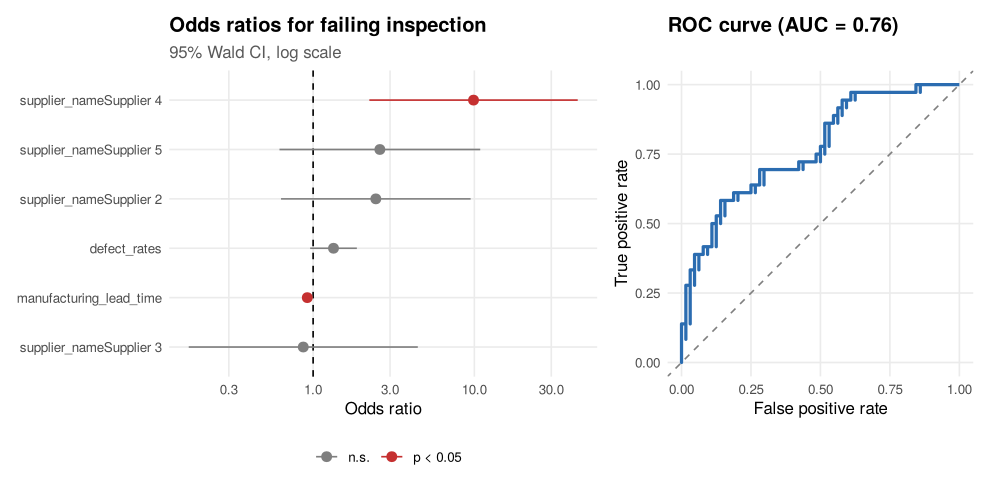
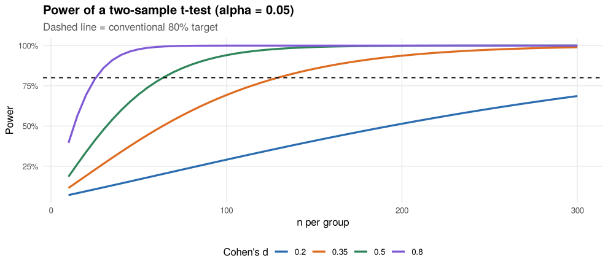

# Statistical Fundamentals in R: Supply Chain Analysis

A complete, reproducible walkthrough of applied statistics in R on one dataset:
100 products (SKUs) of a fashion and beauty company, with 24 variables on pricing,
sales, inventory, suppliers, manufacturing, quality inspection and logistics.

**→ Read the full report: [`analysis/supply_chain_statistics.md`](analysis/supply_chain_statistics.md)**
(code, output, 19 figures, and an English explanation of every method).

Each method is presented in three parts:

1. **What it measures.** The idea and the formula.
2. **When to use it.** The assumptions, and the alternative to use when they fail.
3. **What it says here.** The interpretation for this dataset.

## Methods covered

| Area | Methods |
|---|---|
| **Descriptive: numeric** | mean, median, mode, trimmed / geometric / harmonic mean, variance, SD, SE, range, IQR, MAD, coefficient of variation, quantiles, skewness, excess kurtosis |
| **Outliers** | Tukey fences, z-score, modified z-score (median / MAD) |
| **Concentration** | Lorenz curve, Gini coefficient, top-20% share (Pareto) |
| **Descriptive: categorical** | frequencies, mode, Wilson confidence intervals, Shannon entropy |
| **Distributions** | histograms with KDE, Q-Q plots, Shapiro–Wilk, Anderson–Darling, Lilliefors, Jarque–Bera, MLE distribution fitting with AIC comparison |
| **Confidence intervals** | t-interval; bootstrap percentile, basic and BCa intervals (mean and median) |
| **One-sample tests** | t-test, Wilcoxon signed-rank, exact binomial test, chi-square goodness-of-fit |
| **Two-sample tests** | Student and Welch t-tests, F-test, Levene / Brown–Forsythe, Mann–Whitney U, permutation test |
| **Effect sizes** | Cohen's d, Hedges' g, rank-biserial r, η², ω², ε², Cramér's V, odds ratio |
| **ANOVA family** | one-way ANOVA with assumption checks, Bartlett, Welch ANOVA, Kruskal–Wallis, Tukey HSD, Games–Howell, Dunn (Holm) post-hoc, two-way ANOVA with interaction (Type II SS) |
| **Categorical association** | chi-square test of independence, expected-count check, Fisher's exact test (Monte Carlo), standardised residuals, mosaic plot, two-proportion test |
| **Correlation** | Pearson, Spearman, Kendall, CIs, BH-adjusted correlation matrix, partial correlation |
| **Linear regression** | OLS, confidence vs. prediction intervals, standardised coefficients, R² / adjusted R², F-test, AIC / BIC, nested-model F-test, diagnostic plots, Breusch–Pagan, RESET, Durbin–Watson, (G)VIF, Cook's distance, leverage, robust HC3 standard errors |
| **Logistic regression** | odds ratios with CIs, likelihood-ratio test, McFadden and Tjur R², confusion matrix, sensitivity / specificity, ROC curve and AUC |
| **Power analysis** | post-hoc power, a-priori sample size, minimum detectable effect, power curves |
| **Multiple testing** | Bonferroni, Holm, Benjamini–Hochberg (FDR) |

## Key findings

| Question | Answer |
|---|---|
| What do the distributions look like? | All 15 numeric variables are symmetric with excess kurtosis between −1.1 and −1.4, close to a **uniform distribution**. None passes Shapiro–Wilk, and there are no outliers. The data are most likely simulated. |
| Does inspection outcome depend on the supplier? | **Yes.** Fisher p = 0.005, Cramér's V = 0.28. **Supplier 4** fails 67% of inspections and passes none, against 29% failures for the other suppliers. In the logistic regression its odds ratio is ≈ 10 (95% CI 2.2–43.8). |
| Does the shipping carrier matter for defect rates? | **Carrier B** has lower defect rates than A and C (ANOVA p = 0.007, ω² = 0.08; the Tukey, Games–Howell and Dunn tests agree). The effect holds in the multiple regression and survives the BH correction, but not the stricter Holm correction. |
| Is the defect rate above the 2% target? | The mean is 2.28% (95% CI 1.99–2.57%), with p = 0.061. This is **inconclusive**: the test had only 47% power. |
| Do failed products have higher defect rates? | The difference is 0.53 pp (Hedges' g = 0.36), with p = 0.16 and power of only 26%. About 125 products per group would be needed to detect it reliably. |
| Is lead time related to defects? | r = 0.30 (raw p = 0.003), but none of the 105 correlations survives the BH correction. This is a **data-generated hypothesis** and a lesson in multiple comparisons. |
| Is revenue concentrated in a few SKUs? | No. Gini = 0.27, and the top 20% of SKUs earn 32% of revenue. |

## Selected figures

<p float="left">
  
  
</p>
<p float="left">
  
  
</p>
<p float="left">
  
  
</p>

## Methodological lessons in this analysis

- **Normality tests and Q-Q plots tell different stories.** Here normality is rejected because the tails are too *light* (uniform data), not because the data are skewed. The S-shaped Q-Q plots show this immediately.
- **"Not significant" does not mean "no effect".** Two comparisons show small-to-medium effects that the power analysis proves we could not have detected with n = 100.
- **Multiple comparisons.** Scanning 105 correlations produced 4 "significant" pairs. That is *fewer* than the 5.2 expected by pure chance, and none survives correction.
- **Model fit vs. single coefficients.** Carrier B is individually significant in the regression, yet AIC and BIC prefer the simpler model, and the partial F-test for the added block is not significant (p = 0.15).
- **Small cells.** The supplier × inspection table sits exactly at the chi-square rule-of-thumb limit, so Fisher's exact test is reported instead.

## Run it

Open `RStudio_Statistic_Fundamentals.Rproj` in RStudio and knit
`analysis/supply_chain_statistics.Rmd`, or from a terminal:

```bash
Rscript run_analysis.R      # installs missing packages, then renders the report (~15 s)
```

Built with R 4.3. The packages are listed in [`R/install_packages.R`](R/install_packages.R).

## Project structure

```
data/supply_chain_data.csv            raw data (100 SKUs x 24 variables)
analysis/supply_chain_statistics.Rmd  the analysis (R Markdown, open in RStudio)
analysis/supply_chain_statistics.md   rendered report, readable on GitHub
analysis/figures/                     19 generated figures
R/helpers.R                           documented helper functions (Gini, entropy, Wilson CI, ...)
R/install_packages.R                  dependency installer
run_analysis.R                        one-command render
```

## Data

The supply chain dataset is from Kaggle
([Supply Chain Analysis](https://www.kaggle.com/datasets/harshsingh2209/supply-chain-analysis)).
It contains 100 rows, no missing values, and one row per SKU. Its uniform-like marginal
distributions suggest it was generated synthetically, so the findings illustrate the
methods rather than a real company's operations.
