Statistical Fundamentals in R: Supply Chain Analysis
================

- [1. Data overview and quality](#1-data-overview-and-quality)
- [2. Descriptive statistics: numeric
  variables](#2-descriptive-statistics-numeric-variables)
  - [Outliers](#outliers)
  - [Concentration: Pareto and Lorenz
    curve](#concentration-pareto-and-lorenz-curve)
- [3. Descriptive statistics: categorical
  variables](#3-descriptive-statistics-categorical-variables)
  - [Goodness-of-fit and binomial
    tests](#goodness-of-fit-and-binomial-tests)
- [4. Distributions and normality](#4-distributions-and-normality)
  - [Distribution fitting](#distribution-fitting)
- [5. Confidence intervals and the
  bootstrap](#5-confidence-intervals-and-the-bootstrap)
- [6. Hypothesis tests: one sample](#6-hypothesis-tests-one-sample)
- [7. Hypothesis tests: two groups](#7-hypothesis-tests-two-groups)
- [8. Hypothesis tests: more than two groups (ANOVA
  family)](#8-hypothesis-tests-more-than-two-groups-anova-family)
  - [Two-way ANOVA with interaction](#two-way-anova-with-interaction)
- [9. Association between categorical
  variables](#9-association-between-categorical-variables)
- [10. Correlation](#10-correlation)
- [11. Regression](#11-regression)
  - [Simple linear regression](#simple-linear-regression)
  - [Multiple linear regression and
    diagnostics](#multiple-linear-regression-and-diagnostics)
  - [Logistic regression](#logistic-regression)
- [12. Statistical power and sample
  size](#12-statistical-power-and-sample-size)
- [13. Multiple testing](#13-multiple-testing)
- [14. Summary of findings](#14-summary-of-findings)

This notebook walks through the core toolkit of applied statistics on
one dataset: descriptive statistics, distributions, confidence
intervals, hypothesis tests, effect sizes, correlation, regression,
resampling, power analysis, and multiple-testing correction.

Every section follows the same structure:

- **What it measures.** The idea behind the method.
- **When to use it.** Its assumptions, and the alternative to use when
  they fail.
- **Result.** What the numbers say about this dataset.

The data describe 100 products (SKUs) of a fashion and beauty company:
pricing, sales, inventory, suppliers, manufacturing, quality inspection,
and logistics.

``` r
library(dplyr)
library(tidyr)
library(ggplot2)
library(patchwork)
library(scales)
source(file.path("..", "R", "helpers.R"))
```

# 1. Data overview and quality

``` r
raw <- read.csv(file.path("..", "data", "supply_chain_data.csv"), check.names = FALSE)

# Syntactic, snake_case column names make the code easier to read.
sc <- raw
names(sc) <- tolower(gsub("[^A-Za-z]+", "_", names(sc)))
sc <- sc %>%
  rename(lead_time_customer = lead_times,      # "Lead times": order-to-delivery
         lead_time_supplier = lead_time) %>%   # "Lead time": supplier lead time
  mutate(across(where(is.character) & !sku, factor))

dim(sc)
```

    #> [1] 100  24

``` r
str(sc)
```

    #> 'data.frame':    100 obs. of  24 variables:
    #>  $ product_type           : Factor w/ 3 levels "cosmetics","haircare",..: 2 3 2 3 3 2 3 1 1 3 ...
    #>  $ sku                    : chr  "SKU0" "SKU1" "SKU2" "SKU3" ...
    #>  $ price                  : num  69.81 14.84 11.32 61.16 4.81 ...
    #>  $ availability           : int  55 95 34 68 26 87 48 59 78 35 ...
    #>  $ number_of_products_sold: int  802 736 8 83 871 147 65 426 150 980 ...
    #>  $ revenue_generated      : num  8662 7461 9578 7767 2687 ...
    #>  $ customer_demographics  : Factor w/ 4 levels "Female","Male",..: 3 1 4 3 3 3 2 1 1 4 ...
    #>  $ stock_levels           : int  58 53 1 23 5 90 11 93 5 14 ...
    #>  $ lead_time_customer     : int  7 30 10 13 3 27 15 17 10 27 ...
    #>  $ order_quantities       : int  96 37 88 59 56 66 58 11 15 83 ...
    #>  $ shipping_times         : int  4 2 2 6 8 3 8 1 7 1 ...
    #>  $ shipping_carriers      : Factor w/ 3 levels "Carrier A","Carrier B",..: 2 1 2 3 1 2 3 2 3 1 ...
    #>  $ shipping_costs         : num  2.96 9.72 8.05 1.73 3.89 ...
    #>  $ supplier_name          : Factor w/ 5 levels "Supplier 1","Supplier 2",..: 3 3 1 5 1 4 3 4 4 2 ...
    #>  $ location               : Factor w/ 5 levels "Bangalore","Chennai",..: 5 5 5 4 3 1 4 1 5 2 ...
    #>  $ lead_time_supplier     : int  29 23 12 24 5 10 14 22 13 29 ...
    #>  $ production_volumes     : int  215 517 971 937 414 104 314 564 769 963 ...
    #>  $ manufacturing_lead_time: int  29 30 27 18 3 17 24 1 8 23 ...
    #>  $ manufacturing_costs    : num  46.3 33.6 30.7 35.6 92.1 ...
    #>  $ inspection_results     : Factor w/ 3 levels "Fail","Pass",..: 3 3 3 1 1 1 3 1 3 3 ...
    #>  $ defect_rates           : num  0.226 4.854 4.581 4.747 3.146 ...
    #>  $ transportation_modes   : Factor w/ 4 levels "Air","Rail","Road",..: 3 3 1 2 1 3 4 3 4 2 ...
    #>  $ routes                 : Factor w/ 3 levels "Route A","Route B",..: 2 2 3 1 1 1 1 3 2 2 ...
    #>  $ costs                  : num  188 503 142 255 923 ...

``` r
quality <- data.frame(
  missing_values = sum(is.na(sc)),
  duplicate_rows = sum(duplicated(sc)),
  duplicate_skus = sum(duplicated(sc$sku))
)
knitr::kable(quality)
```

| missing_values | duplicate_rows | duplicate_skus |
|---------------:|---------------:|---------------:|
|              0 |              0 |              0 |

**Result.** The data has 100 rows and 24 columns, with no missing
values, no duplicate rows, and one row per SKU. That gives 15 numeric
and 8 categorical variables (plus the SKU identifier).

``` r
num_vars <- names(sc)[sapply(sc, is.numeric)]
cat_vars <- setdiff(names(sc)[sapply(sc, is.factor)], "sku")
num_vars
```

    #>  [1] "price"                   "availability"            "number_of_products_sold" "revenue_generated"      
    #>  [5] "stock_levels"            "lead_time_customer"      "order_quantities"        "shipping_times"         
    #>  [9] "shipping_costs"          "lead_time_supplier"      "production_volumes"      "manufacturing_lead_time"
    #> [13] "manufacturing_costs"     "defect_rates"            "costs"

``` r
cat_vars
```

    #> [1] "product_type"          "customer_demographics" "shipping_carriers"     "supplier_name"        
    #> [5] "location"              "inspection_results"    "transportation_modes"  "routes"

# 2. Descriptive statistics: numeric variables

**What it measures.** Descriptive statistics summarise a variable along
three axes.

- **Central tendency (where the typical value is).**
  - *Mean*: the arithmetic average. It is sensitive to outliers.
  - *Median*: the 50th percentile. It is robust to outliers.
  - *10% trimmed mean*: the mean after dropping the top and bottom 10%.
    It sits between the mean and the median.
  - *Geometric mean* and *harmonic mean*: for multiplicative quantities
    and for rates. For positive data the order is always harmonic ≤
    geometric ≤ arithmetic.
- **Dispersion (how spread out the values are).**
  - *Variance* and *standard deviation (SD)*: the average squared
    distance from the mean, and its square root.
  - *Range*: maximum minus minimum.
  - *IQR*: Q3 − Q1, the range of the middle 50%.
  - *MAD*: the median absolute deviation, a robust version of the SD.
  - *Coefficient of variation (CV)*: SD / mean. It is unit-free, so it
    can compare a price and a lead time.
- **Uncertainty of the mean.**
  - *Standard error (SE)*: SD / √n.
  - *95% confidence interval*: mean ± t(0.975, n−1) · SE. It is the
    range of population means compatible with the sample.
- **Shape.**
  - *Skewness*: 0 = symmetric, \> 0 = long right tail.
  - *Excess kurtosis*: 0 = normal. Below 0 means flatter with thin tails
    (platykurtic); above 0 means peaked with heavy tails.

``` r
desc <- do.call(rbind, lapply(sc[num_vars], describe_numeric))
desc_view <- round_df(desc[, c("mean", "trim_mean", "median", "sd", "se_mean", "ci95_low",
                               "ci95_high", "cv", "min", "q1", "q3", "max", "iqr", "mad",
                               "skewness", "kurtosis")], 2)
knitr::kable(desc_view)
```

|                         |    mean | trim_mean |  median |      sd | se_mean | ci95_low | ci95_high |   cv |     min |      q1 |      q3 |     max |     iqr |     mad | skewness | kurtosis |
|:------------------------|--------:|----------:|--------:|--------:|--------:|---------:|----------:|-----:|--------:|--------:|--------:|--------:|--------:|--------:|---------:|---------:|
| price                   |   49.46 |     49.36 |   51.24 |   31.17 |    3.12 |    43.28 |     55.65 | 0.63 |    1.70 |   19.60 |   77.20 |   99.17 |   57.60 |   41.95 |    -0.02 |    -1.37 |
| availability            |   48.40 |     47.71 |   43.50 |   30.74 |    3.07 |    42.30 |     54.50 | 0.64 |    1.00 |   22.75 |   75.00 |  100.00 |   52.25 |   40.77 |     0.18 |    -1.33 |
| number_of_products_sold |  460.99 |    450.45 |  392.50 |  303.78 |   30.38 |   400.71 |    521.27 | 0.66 |    8.00 |  184.25 |  704.25 |  996.00 |  520.00 |  358.05 |     0.28 |    -1.25 |
| revenue_generated       | 5776.05 |   5817.38 | 6006.35 | 2732.84 |  273.28 |  5233.79 |   6318.30 | 0.47 | 1061.62 | 2812.85 | 8253.98 | 9866.47 | 5441.13 | 3666.38 |    -0.17 |    -1.42 |
| stock_levels            |   47.77 |     47.17 |   47.50 |   31.37 |    3.14 |    41.55 |     53.99 | 0.66 |    0.00 |   16.75 |   73.00 |  100.00 |   56.25 |   43.00 |     0.10 |    -1.23 |
| lead_time_customer      |   15.96 |     16.18 |   17.00 |    8.79 |    0.88 |    14.22 |     17.70 | 0.55 |    1.00 |    8.00 |   24.00 |   30.00 |   16.00 |   11.86 |    -0.13 |    -1.19 |
| order_quantities        |   49.22 |     49.52 |   52.00 |   26.78 |    2.68 |    43.91 |     54.53 | 0.54 |    1.00 |   26.00 |   71.25 |   96.00 |   45.25 |   34.84 |    -0.11 |    -1.12 |
| shipping_times          |    5.75 |      5.86 |    6.00 |    2.72 |    0.27 |     5.21 |      6.29 | 0.47 |    1.00 |    3.75 |    8.00 |   10.00 |    4.25 |    2.97 |    -0.28 |    -1.07 |
| shipping_costs          |    5.55 |      5.57 |    5.32 |    2.65 |    0.27 |     5.02 |      6.07 | 0.48 |    1.01 |    3.54 |    7.60 |    9.93 |    4.06 |    3.31 |    -0.05 |    -1.18 |
| lead_time_supplier      |   17.08 |     17.48 |   18.00 |    8.85 |    0.88 |    15.32 |     18.84 | 0.52 |    1.00 |   10.00 |   25.00 |   30.00 |   15.00 |   11.12 |    -0.33 |    -1.17 |
| production_volumes      |  567.84 |    570.78 |  568.50 |  263.05 |   26.30 |   515.65 |    620.03 | 0.46 |  104.00 |  352.00 |  797.00 |  985.00 |  445.00 |  341.00 |    -0.08 |    -1.29 |
| manufacturing_lead_time |   14.77 |     14.59 |   14.00 |    8.91 |    0.89 |    13.00 |     16.54 | 0.60 |    1.00 |    7.00 |   23.00 |   30.00 |   16.00 |   11.12 |     0.18 |    -1.29 |
| manufacturing_costs     |   47.27 |     46.34 |   45.91 |   28.98 |    2.90 |    41.52 |     53.02 | 0.61 |    1.09 |   22.98 |   68.62 |   99.47 |   45.64 |   34.20 |     0.19 |    -1.09 |
| defect_rates            |    2.28 |      2.24 |    2.14 |    1.46 |    0.15 |     1.99 |      2.57 | 0.64 |    0.02 |    1.01 |    3.56 |    4.94 |    2.55 |    1.88 |     0.13 |    -1.11 |
| costs                   |  529.25 |    527.39 |  520.43 |  258.30 |   25.83 |   477.99 |    580.50 | 0.49 |  103.92 |  318.78 |  763.08 |  997.41 |  444.30 |  355.11 |     0.04 |    -1.17 |

``` r
knitr::kable(round_df(desc[, c("mean", "geo_mean", "harm_mean", "variance", "range",
                               "p05", "p95")], 2))
```

|                         |    mean | geo_mean | harm_mean |   variance |   range |     p05 |     p95 |
|:------------------------|--------:|---------:|----------:|-----------:|--------:|--------:|--------:|
| price                   |   49.46 |    34.60 |     17.40 |     971.46 |   97.47 |    4.05 |   96.40 |
| availability            |   48.40 |    35.08 |     16.91 |     945.15 |   99.00 |    5.95 |   96.05 |
| number_of_products_sold |  460.99 |   329.28 |    162.86 |   92282.33 |  988.00 |   60.50 |  960.15 |
| revenue_generated       | 5776.05 |  4974.34 |   4091.09 | 7468424.00 | 8804.85 | 1835.25 | 9571.86 |
| stock_levels            |   47.77 |       NA |        NA |     984.04 |  100.00 |    4.00 |   97.00 |
| lead_time_customer      |   15.96 |    12.17 |      6.82 |      77.19 |   29.00 |    1.00 |   29.00 |
| order_quantities        |   49.22 |    38.04 |     20.28 |     717.41 |   95.00 |    7.00 |   88.00 |
| shipping_times          |    5.75 |     4.84 |      3.65 |       7.42 |    9.00 |    1.00 |   10.00 |
| shipping_costs          |    5.55 |     4.76 |      3.85 |       7.03 |    8.92 |    1.41 |    9.57 |
| lead_time_supplier      |   17.08 |    13.38 |      7.91 |      78.26 |   29.00 |    2.00 |   29.00 |
| production_volumes      |  567.84 |   493.70 |    409.95 |   69193.65 |  881.00 |  172.90 |  953.10 |
| manufacturing_lead_time |   14.77 |    11.34 |      7.32 |      79.43 |   29.00 |    2.00 |   29.00 |
| manufacturing_costs     |   47.27 |    34.73 |     17.43 |     840.01 |   98.38 |    5.78 |   97.11 |
| defect_rates            |    2.28 |     1.51 |      0.44 |       2.14 |    4.92 |    0.13 |    4.75 |
| costs                   |  529.25 |   453.60 |    370.21 |   66719.77 |  893.50 |  134.04 |  923.73 |

``` r
desc %>%
  mutate(variable = reorder(rownames(desc), cv)) %>%
  ggplot(aes(cv, variable)) +
  geom_col(fill = PALETTE[1]) +
  geom_text(aes(label = percent(cv, 1)), hjust = -0.15, size = 3.2) +
  scale_x_continuous(labels = percent, expand = expansion(mult = c(0, .12))) +
  labs(title = "Relative variability (coefficient of variation)",
       subtitle = "SD as a share of the mean: comparable across units", x = "CV", y = NULL) +
  theme_stats()
```

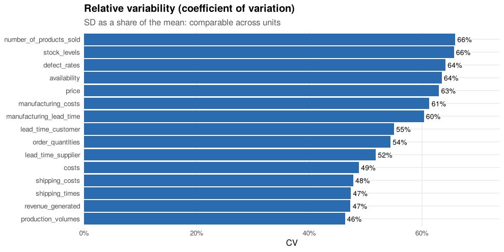

**Result.**

- For almost every variable the mean and the median are close and the
  skewness is near 0, so the distributions are symmetric.
- Excess kurtosis lies between −1.1 and −1.4 for every variable, close
  to −1.2, the value of a **uniform distribution**. Values are spread
  evenly between the minimum and the maximum, with no central peak. This
  pattern is typical of simulated data, and we keep it in mind when
  interpreting the tests below.
- Defect rates (`defect_rates`) average 2.28% (95% CI 1.99% to 2.57%).
- Number of products sold has the largest relative variability (CV 66%).

## Outliers

There are three detection rules. The z-score rule assumes normality.
Tukey’s fences and the modified z-score use quartiles and medians, so
they are robust to the outliers they are trying to find.

``` r
out_tab <- t(sapply(sc[num_vars], outlier_counts))
knitr::kable(out_tab)
```

|                         | tukey | z_score | modified |
|:------------------------|------:|--------:|---------:|
| price                   |     0 |       0 |        0 |
| availability            |     0 |       0 |        0 |
| number_of_products_sold |     0 |       0 |        0 |
| revenue_generated       |     0 |       0 |        0 |
| stock_levels            |     0 |       0 |        0 |
| lead_time_customer      |     0 |       0 |        0 |
| order_quantities        |     0 |       0 |        0 |
| shipping_times          |     0 |       0 |        0 |
| shipping_costs          |     0 |       0 |        0 |
| lead_time_supplier      |     0 |       0 |        0 |
| production_volumes      |     0 |       0 |        0 |
| manufacturing_lead_time |     0 |       0 |        0 |
| manufacturing_costs     |     0 |       0 |        0 |
| defect_rates            |     0 |       0 |        0 |
| costs                   |     0 |       0 |        0 |

``` r
sc %>%
  select(all_of(num_vars)) %>%
  mutate(across(everything(), ~ as.numeric(scale(.x)))) %>%
  pivot_longer(everything()) %>%
  ggplot(aes(value, reorder(name, value, FUN = IQR))) +
  geom_boxplot(fill = PALETTE[1], alpha = .25, outlier.colour = PALETTE[2]) +
  labs(title = "Standardised distributions (z-scores)",
       subtitle = "Box = IQR, whiskers = 1.5 x IQR (Tukey fences)", x = "z-score", y = NULL) +
  theme_stats()
```

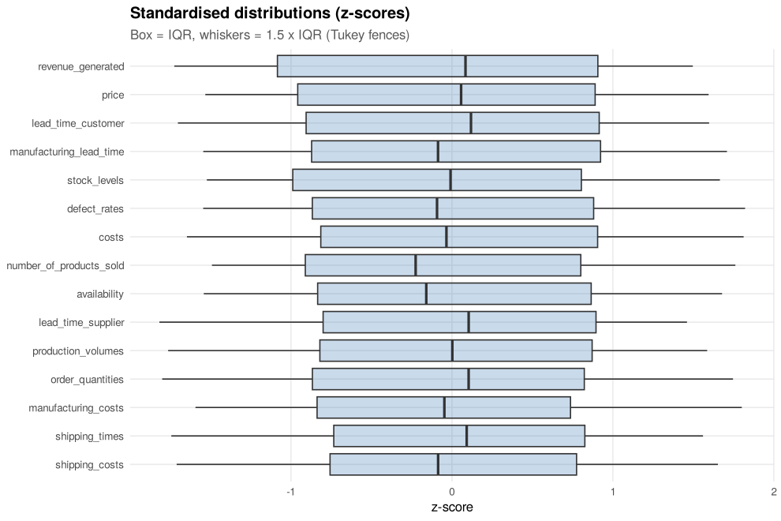

**Result.** None of the rules finds an outlier in any variable.
Uniform-like data has short tails, so this is expected.

## Concentration: Pareto and Lorenz curve

In supply chains, a few products often generate most of the revenue (the
“80/20 rule”). The **Lorenz curve** plots the cumulative share of
revenue against the cumulative share of products. The **Gini
coefficient** is twice the area between the curve and the equality line:
0 means every product earns the same, 1 means one product earns
everything.

``` r
rev_sorted <- sort(sc$revenue_generated, decreasing = TRUE)
top20_share <- sum(rev_sorted[1:20]) / sum(rev_sorted)
g_rev <- gini(sc$revenue_generated)

lorenz <- data.frame(p = c(0, seq_along(rev_sorted) / length(rev_sorted)),
                     L = c(0, cumsum(sort(sc$revenue_generated)) / sum(sc$revenue_generated)))
ggplot(lorenz, aes(p, L)) +
  geom_abline(linetype = 2, colour = "grey50") +
  geom_area(fill = PALETTE[1], alpha = .15) +
  geom_line(colour = PALETTE[1], linewidth = 1) +
  scale_x_continuous(labels = percent) + scale_y_continuous(labels = percent) +
  labs(title = sprintf("Lorenz curve of revenue (Gini = %.2f)", g_rev),
       subtitle = "Dashed line = perfect equality",
       x = "Cumulative share of products (lowest to highest revenue)",
       y = "Cumulative share of revenue") +
  coord_equal() + theme_stats()
```

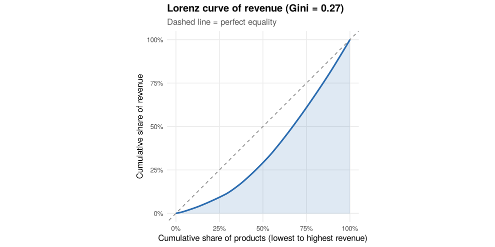

**Result.** The Gini coefficient is 0.27, and the top 20% of SKUs
generate 32% of revenue. That is far below the 80% of a classic Pareto
pattern. Revenue is spread fairly evenly, so no small group of “hero
products” dominates.

# 3. Descriptive statistics: categorical variables

**What it measures.**

- **Frequencies and proportions.**
- The **mode**: the most frequent category.
- **95% Wilson confidence intervals** for each proportion.
- **Normalised Shannon entropy**: 0 means all observations are in one
  category, 1 means they are spread perfectly evenly.

``` r
cat_summary <- do.call(rbind, lapply(cat_vars, function(v) {
  e <- entropy(sc[[v]])
  data.frame(variable = v, levels = nlevels(sc[[v]]), mode = stat_mode(sc[[v]]),
             mode_share = max(prop.table(table(sc[[v]]))),
             entropy_bits = e[["entropy_bits"]], entropy_normalised = e[["normalised"]])
}))
knitr::kable(round_df(cat_summary, 3))
```

| variable              | levels | mode       | mode_share | entropy_bits | entropy_normalised |
|:----------------------|-------:|:-----------|-----------:|-------------:|-------------------:|
| product_type          |      3 | skincare   |       0.40 |        1.563 |              0.986 |
| customer_demographics |      4 | Unknown    |       0.31 |        1.984 |              0.992 |
| shipping_carriers     |      3 | Carrier B  |       0.43 |        1.556 |              0.982 |
| supplier_name         |      5 | Supplier 1 |       0.27 |        2.292 |              0.987 |
| location              |      5 | Kolkata    |       0.25 |        2.301 |              0.991 |
| inspection_results    |      3 | Pending    |       0.41 |        1.546 |              0.975 |
| transportation_modes  |      4 | Road       |       0.29 |        1.972 |              0.986 |
| routes                |      3 | Route A    |       0.43 |        1.519 |              0.958 |

``` r
insp <- wilson_table(sc$inspection_results)
knitr::kable(round_df(insp, 3))
```

| level   | count | proportion | ci_low | ci_high |
|:--------|------:|-----------:|-------:|--------:|
| Fail    |    36 |       0.36 |  0.273 |   0.458 |
| Pass    |    23 |       0.23 |  0.158 |   0.322 |
| Pending |    41 |       0.41 |  0.319 |   0.508 |

``` r
ggplot(insp, aes(proportion, reorder(level, proportion))) +
  geom_col(fill = PALETTE[1], alpha = .8) +
  geom_errorbarh(aes(xmin = ci_low, xmax = ci_high), height = .25) +
  scale_x_continuous(labels = percent) +
  labs(title = "Quality inspection outcomes", subtitle = "Bars: share, whiskers: 95% Wilson CI",
       x = "Share of SKUs", y = NULL) +
  theme_stats()
```

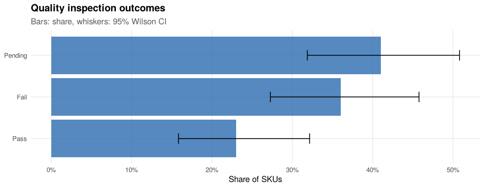

## Goodness-of-fit and binomial tests

- The **chi-square goodness-of-fit test** checks whether the observed
  category frequencies match the expected ones. Here H0 is that all
  product types are equally common.
- The **exact binomial test** checks one proportion against a target
  value. Here H0 is that the inspection failure rate equals the 30%
  quality benchmark. It uses the binomial distribution directly, with no
  normal approximation.

``` r
gof <- chisq.test(table(sc$product_type))
gof
```

    #> 
    #>  Chi-squared test for given probabilities
    #> 
    #> data:  table(sc$product_type)
    #> X-squared = 3, df = 2, p-value = 0.2

``` r
binom <- binom.test(sum(sc$inspection_results == "Fail"), nrow(sc), p = 0.30)
binom
```

    #> 
    #>  Exact binomial test
    #> 
    #> data:  sum(sc$inspection_results == "Fail") and nrow(sc)
    #> number of successes = 36, number of trials = 100, p-value = 0.2
    #> alternative hypothesis: true probability of success is not equal to 0.3
    #> 95 percent confidence interval:
    #>  0.2664 0.4621
    #> sample estimates:
    #> probability of success 
    #>                   0.36

**Result.**

- Product types are equally represented (χ² = 2.96, p = 0.228).
- The failure rate is 36% (95% CI 27% to 46%). This is not significantly
  different from the 30% benchmark (p = 0.192). The interval is wide
  because n = 100.

# 4. Distributions and normality

Many classical tests (t-test, ANOVA, the linear regression CIs) assume
normally distributed data or residuals. We check this graphically and
formally.

| Test                 | H0                                   | Sensitive to                                    |
|----------------------|--------------------------------------|-------------------------------------------------|
| **Shapiro–Wilk**     | data are normal                      | most powerful general test for n \< 5000        |
| **Anderson–Darling** | data are normal                      | deviations in the tails                         |
| **Lilliefors (KS)**  | data are normal                      | the largest CDF gap, with mean and SD estimated |
| **Jarque–Bera**      | skewness = 0 and excess kurtosis = 0 | the shape (third and fourth moments)            |

A small p-value is evidence **against** normality. Always look at the
Q-Q plot too. With large n, the tests flag trivial deviations. With
small n, they miss large ones.

``` r
jarque_bera <- function(x) {
  n <- length(x)
  s <- e1071::skewness(x, type = 1); k <- e1071::kurtosis(x, type = 1)
  jb <- n / 6 * (s^2 + k^2 / 4)
  c(statistic = jb, p.value = pchisq(jb, df = 2, lower.tail = FALSE))
}
norm_tab <- do.call(rbind, lapply(num_vars, function(v) {
  x <- sc[[v]]
  data.frame(variable = v,
             shapiro_W = unname(shapiro.test(x)$statistic), shapiro_p = shapiro.test(x)$p.value,
             anderson_p = nortest::ad.test(x)$p.value,
             lilliefors_p = nortest::lillie.test(x)$p.value,
             jarque_bera_p = jarque_bera(x)[["p.value"]])
}))
norm_tab$normal_at_5pct <- norm_tab$shapiro_p > 0.05
knitr::kable(round_df(norm_tab, 4))
```

| variable                | shapiro_W | shapiro_p | anderson_p | lilliefors_p | jarque_bera_p | normal_at_5pct |
|:------------------------|----------:|----------:|-----------:|-------------:|--------------:|:---------------|
| price                   |    0.9299 |    0.0000 |     0.0000 |       0.0161 |        0.0205 | FALSE          |
| availability            |    0.9286 |    0.0000 |     0.0000 |       0.0015 |        0.0196 | FALSE          |
| number_of_products_sold |    0.9285 |    0.0000 |     0.0000 |       0.0092 |        0.0204 | FALSE          |
| revenue_generated       |    0.9173 |    0.0000 |     0.0000 |       0.0001 |        0.0127 | FALSE          |
| stock_levels            |    0.9378 |    0.0001 |     0.0006 |       0.0178 |        0.0388 | FALSE          |
| lead_time_customer      |    0.9462 |    0.0005 |     0.0015 |       0.0055 |        0.0457 | FALSE          |
| order_quantities        |    0.9572 |    0.0025 |     0.0057 |       0.0618 |        0.0657 | FALSE          |
| shipping_times          |    0.9354 |    0.0001 |     0.0001 |       0.0000 |        0.0468 | FALSE          |
| shipping_costs          |    0.9515 |    0.0010 |     0.0041 |       0.1227 |        0.0525 | FALSE          |
| lead_time_supplier      |    0.9314 |    0.0001 |     0.0000 |       0.0031 |        0.0237 | FALSE          |
| production_volumes      |    0.9408 |    0.0002 |     0.0003 |       0.0178 |        0.0299 | FALSE          |
| manufacturing_lead_time |    0.9336 |    0.0001 |     0.0001 |       0.0028 |        0.0237 | FALSE          |
| manufacturing_costs     |    0.9529 |    0.0013 |     0.0071 |       0.1619 |        0.0603 | FALSE          |
| defect_rates            |    0.9533 |    0.0014 |     0.0093 |       0.2082 |        0.0644 | FALSE          |
| costs                   |    0.9546 |    0.0017 |     0.0048 |       0.0283 |        0.0567 | FALSE          |

``` r
qq_vars <- c("price", "revenue_generated", "defect_rates", "shipping_costs",
             "lead_time_supplier", "manufacturing_costs")
sc %>%
  select(all_of(qq_vars)) %>%
  pivot_longer(everything()) %>%
  ggplot(aes(sample = value)) +
  stat_qq(colour = PALETTE[1], size = 1.2) +
  stat_qq_line(colour = PALETTE[2]) +
  facet_wrap(~ name, scales = "free_y") +
  labs(title = "Normal Q-Q plots",
       subtitle = "S-shaped curve = lighter tails than normal (typical of a uniform distribution)",
       x = "Theoretical normal quantiles", y = "Sample quantiles") +
  theme_stats()
```

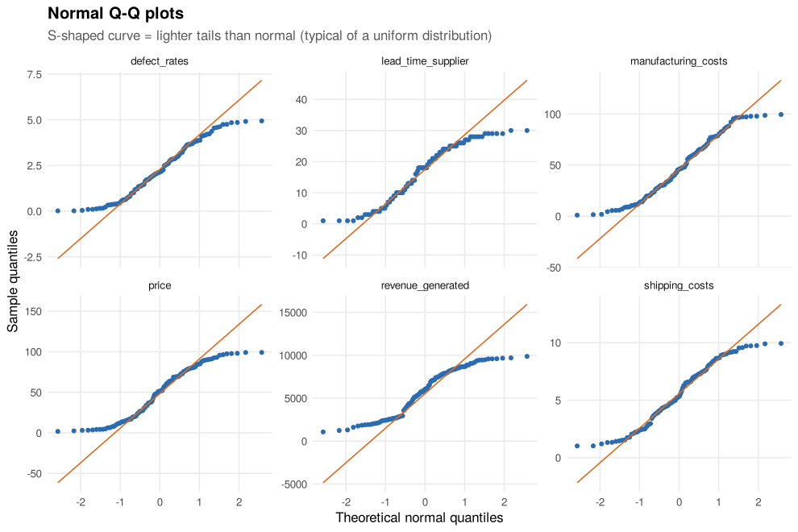

``` r
sc %>%
  select(all_of(qq_vars)) %>%
  pivot_longer(everything()) %>%
  ggplot(aes(value)) +
  geom_histogram(aes(y = after_stat(density)), bins = 15, fill = PALETTE[1], alpha = .35) +
  geom_density(colour = PALETTE[1], linewidth = .9) +
  facet_wrap(~ name, scales = "free") +
  labs(title = "Histograms with kernel density estimates", x = NULL, y = "Density") +
  theme_stats()
```

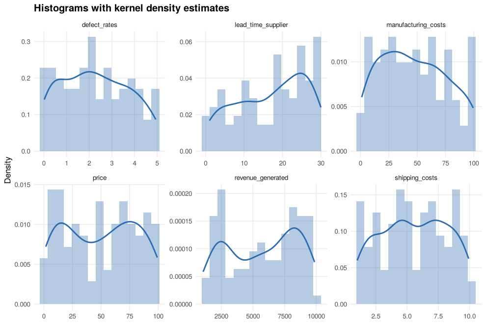

**Result.** Only 0 of 15 variables pass Shapiro–Wilk at the 5% level.
The Q-Q plots show a characteristic **S-shape**: the tails are shorter
than normal, not longer. The flat histograms point the same way. This is
a uniform-like distribution, not skewness. The practical conclusion is
to report non-parametric tests next to the parametric ones. For mean
comparisons with n ≥ 20 per group, the t-test is still reasonably robust
(central limit theorem).

## Distribution fitting

`fitdistrplus` fits candidate distributions by maximum likelihood. We
compare them with **AIC** (Akaike Information Criterion) = 2k −
2·log-likelihood. Lower is better: it rewards fit and penalises extra
parameters.

``` r
library(fitdistrplus)
x <- sc$price
fits <- list(
  normal    = fitdist(x, "norm"),
  lognormal = fitdist(x, "lnorm"),
  gamma     = fitdist(x / 10, "gamma"),     # rescaled for numerical stability
  uniform   = fitdist(x, "unif", method = "mme")
)
aic <- sapply(fits, function(f) {
  ll <- if (f$distname == "unif") sum(dunif(x, f$estimate["min"], f$estimate["max"], log = TRUE))
        else if (f$distname == "gamma") f$loglik - length(x) * log(10)  # back to original scale
        else f$loglik
  2 * length(f$estimate) - 2 * ll
})
knitr::kable(data.frame(distribution = names(aic), AIC = round(aic, 1))[order(aic), ], row.names = FALSE)
```

| distribution |    AIC |
|:-------------|-------:|
| gamma        |  974.1 |
| normal       |  974.7 |
| lognormal    | 1001.3 |
| uniform      |     NA |

``` r
ks_unif <- ks.test(x, "punif", min(x), max(x))
```

``` r
ggplot(sc, aes(price)) +
  geom_histogram(aes(y = after_stat(density)), bins = 12, fill = "grey80", colour = "white") +
  stat_function(aes(colour = "Normal"), fun = dnorm,
                args = list(mean(x), sd(x)), linewidth = 1) +
  stat_function(aes(colour = "Lognormal"), fun = dlnorm,
                args = as.list(fits$lognormal$estimate), linewidth = 1) +
  stat_function(aes(colour = "Uniform"), fun = dunif,
                args = list(min(x), max(x)), linewidth = 1, n = 500) +
  scale_colour_manual(values = PALETTE[1:3], name = NULL) +
  labs(title = "Price: which distribution fits best?", x = "Price ($)", y = "Density") +
  theme_stats()
```

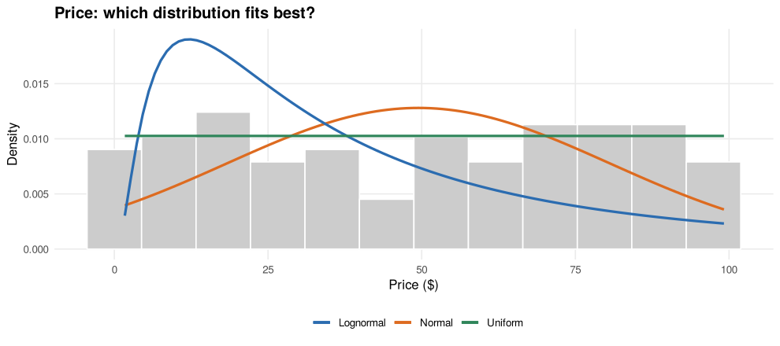

**Result.** The uniform distribution has the lowest AIC for price. A
Kolmogorov–Smirnov test against Uniform(1.7, 99.2) gives p = 0.501, so
uniformity is not rejected. The data were most likely simulated from
uniform distributions. (Strictly, the KS p-value is approximate here,
because the bounds were estimated from the same data.)

# 5. Confidence intervals and the bootstrap

A 95% confidence interval is produced by a procedure that, over repeated
samples, captures the true parameter 95% of the time. We compute the CI
of the **mean defect rate** in four ways, and the CI of the **median**,
which has no simple formula.

- **t-interval**: mean ± t · SE. It assumes the sampling distribution of
  the mean is approximately normal.
- **Bootstrap**: resample the 100 SKUs with replacement 10,000 times,
  recompute the statistic each time, and read the CI from that
  distribution. It makes no distributional assumption.
  - *Percentile*: the 2.5th and 97.5th percentiles of the bootstrap
    estimates.
  - *BCa (bias-corrected and accelerated)*: corrects for bias and
    skewness in the bootstrap distribution. It is usually the most
    accurate.
  - *Basic*: reflects the percentiles around the original estimate.

``` r
library(boot)
b_mean   <- boot(sc$defect_rates, function(d, i) mean(d[i]), R = 10000)
b_median <- boot(sc$defect_rates, function(d, i) median(d[i]), R = 10000)
ci_mean  <- boot.ci(b_mean, type = c("perc", "bca", "basic"))
ci_med   <- boot.ci(b_median, type = c("perc", "bca"))
tci <- t.test(sc$defect_rates)$conf.int

ci_table <- data.frame(
  statistic = c("Mean", "Mean", "Mean", "Mean", "Median", "Median"),
  method    = c("t-interval", "Bootstrap percentile", "Bootstrap BCa", "Bootstrap basic",
                "Bootstrap percentile", "Bootstrap BCa"),
  estimate  = c(rep(mean(sc$defect_rates), 4), rep(median(sc$defect_rates), 2)),
  ci_low    = c(tci[1], ci_mean$percent[4], ci_mean$bca[4], ci_mean$basic[4],
                ci_med$percent[4], ci_med$bca[4]),
  ci_high   = c(tci[2], ci_mean$percent[5], ci_mean$bca[5], ci_mean$basic[5],
                ci_med$percent[5], ci_med$bca[5])
)
knitr::kable(round_df(ci_table, 3))
```

| statistic | method               | estimate | ci_low | ci_high |
|:----------|:---------------------|---------:|-------:|--------:|
| Mean      | t-interval           |    2.277 |  1.987 |   2.567 |
| Mean      | Bootstrap percentile |    2.277 |  1.993 |   2.562 |
| Mean      | Bootstrap BCa        |    2.277 |  1.998 |   2.567 |
| Mean      | Bootstrap basic      |    2.277 |  1.992 |   2.562 |
| Median    | Bootstrap percentile |    2.142 |  1.823 |   2.710 |
| Median    | Bootstrap BCa        |    2.142 |  1.802 |   2.685 |

``` r
data.frame(mean = b_mean$t[, 1]) %>%
  ggplot(aes(mean)) +
  geom_histogram(bins = 50, fill = PALETTE[1], alpha = .5) +
  geom_vline(xintercept = ci_mean$bca[4:5], colour = PALETTE[2], linetype = 2) +
  geom_vline(xintercept = mean(sc$defect_rates), colour = "black") +
  geom_vline(xintercept = 2, colour = PALETTE[5]) +
  annotate("text", x = 2, y = Inf, label = "2% target", vjust = 1.5, hjust = 1.1,
           colour = PALETTE[5]) +
  labs(title = "Bootstrap distribution of the mean defect rate (10,000 resamples)",
       subtitle = "Dashed = 95% BCa interval; solid black = sample mean",
       x = "Mean defect rate (%)", y = "Count") +
  theme_stats()
```

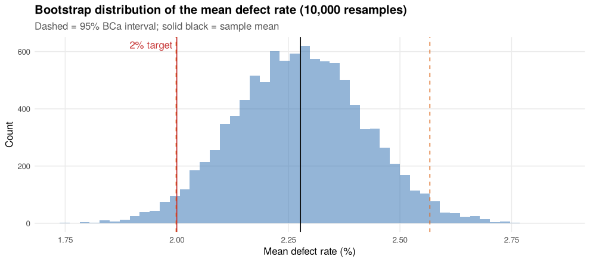

**Result.** All four methods agree to within about 0.01 percentage
points. When the sample is moderately large and the data are symmetric,
the t-interval and the bootstrap give the same answer. The 2% target
lies just inside the lower end of every interval. Section 6 tests this
formally.

# 6. Hypothesis tests: one sample

**Question:** is the average defect rate different from the 2% quality
target?

- **One-sample t-test.**
  - H0: μ = 2. The test statistic is t = (x̄ − 2) / SE, with n − 1
    degrees of freedom.
  - It assumes independent observations and an approximately normal
    sampling distribution of the mean.
- **Wilcoxon signed-rank test.** The non-parametric alternative. H0: the
  distribution is symmetric around 2 (the median is 2). It uses the
  ranks of \|x − 2\|.
- **Effect size: Cohen’s d** = (x̄ − 2) / SD. Rough guide: 0.2 is small,
  0.5 medium, 0.8 large.

``` r
t1 <- t.test(sc$defect_rates, mu = 2)
w1 <- wilcox.test(sc$defect_rates, mu = 2, conf.int = TRUE)
d1 <- effectsize::cohens_d(sc$defect_rates, mu = 2)
t1
```

    #> 
    #>  One Sample t-test
    #> 
    #> data:  sc$defect_rates
    #> t = 1.9, df = 99, p-value = 0.06
    #> alternative hypothesis: true mean is not equal to 2
    #> 95 percent confidence interval:
    #>  1.987 2.567
    #> sample estimates:
    #> mean of x 
    #>     2.277

``` r
w1
```

    #> 
    #>  Wilcoxon signed rank test with continuity correction
    #> 
    #> data:  sc$defect_rates
    #> V = 3009, p-value = 0.1
    #> alternative hypothesis: true location is not equal to 2
    #> 95 percent confidence interval:
    #>  1.955 2.566
    #> sample estimates:
    #> (pseudo)median 
    #>           2.27

``` r
d1
```

    #> Cohen's d |        95% CI
    #> -------------------------
    #> 0.19      | [-0.01, 0.39]
    #> 
    #> - Deviation from a difference of 2.

**Result.**

- The mean defect rate is 2.28%. The t-test gives t(99) = 1.9, p =
  0.061, and the Wilcoxon test gives p = 0.096.
- At α = 0.05 we **cannot reject** H0. The effect is small (d = 0.19).
- This is a textbook case of “not significant ≠ no effect”. The point
  estimate is above target and the p-value is borderline. With 100 SKUs,
  the test has only 47% power to detect an effect of this size (see
  Section 12).

# 7. Hypothesis tests: two groups

**Question:** do products that **failed** inspection have higher defect
rates than those that **passed**?

| Test                                   | Compares                      | Assumes                                                                                   |
|----------------------------------------|-------------------------------|-------------------------------------------------------------------------------------------|
| **F-test**                             | variances                     | normality (very sensitive to it)                                                          |
| **Levene / Brown–Forsythe**            | variances                     | robust: works on deviations from the median                                               |
| **Student’s t-test**                   | means                         | normality and equal variances                                                             |
| **Welch’s t-test**                     | means                         | normality only. It adjusts the df for unequal variances, so it is the recommended default |
| **Mann–Whitney U (Wilcoxon rank-sum)** | distributions, i.e. P(X \> Y) | independent samples, no normality                                                         |
| **Permutation test**                   | means                         | only exchangeability under H0. The p-value comes from shuffling the group labels          |

Effect sizes:

- **Cohen’s d** (pooled SD), and **Hedges’ g**, which is d with a
  small-sample bias correction.
- **Rank-biserial correlation**, which goes with Mann–Whitney. It runs
  from −1 to 1.

``` r
fp <- sc %>% filter(inspection_results %in% c("Fail", "Pass")) %>% droplevels()
fp %>% group_by(inspection_results) %>%
  summarise(n = n(), mean = mean(defect_rates), median = median(defect_rates),
            sd = sd(defect_rates)) %>%
  knitr::kable(digits = 3)
```

| inspection_results |   n |  mean | median |    sd |
|:-------------------|----:|------:|-------:|------:|
| Fail               |  36 | 2.569 |  2.851 | 1.601 |
| Pass               |  23 | 2.039 |  1.946 | 1.226 |

``` r
f_var   <- var.test(defect_rates ~ inspection_results, data = fp)
lev     <- car::leveneTest(defect_rates ~ inspection_results, data = fp, center = median)
t_stud  <- t.test(defect_rates ~ inspection_results, data = fp, var.equal = TRUE)
t_welch <- t.test(defect_rates ~ inspection_results, data = fp)
mw      <- wilcox.test(defect_rates ~ inspection_results, data = fp, conf.int = TRUE)
perm    <- coin::oneway_test(defect_rates ~ inspection_results, data = fp,
                             distribution = coin::approximate(nresample = 10000))
d2      <- effectsize::cohens_d(defect_rates ~ inspection_results, data = fp)
g2      <- effectsize::hedges_g(defect_rates ~ inspection_results, data = fp)
rb2     <- effectsize::rank_biserial(defect_rates ~ inspection_results, data = fp)

two_sample <- data.frame(
  test = c("F-test (variances)", "Brown-Forsythe / Levene (variances)", "Student t",
           "Welch t", "Mann-Whitney U", "Permutation (10,000 shuffles)"),
  statistic = c(f_var$statistic, lev$`F value`[1], t_stud$statistic, t_welch$statistic,
                mw$statistic, coin::statistic(perm)),
  p_value = c(f_var$p.value, lev$`Pr(>F)`[1], t_stud$p.value, t_welch$p.value, mw$p.value,
              coin::pvalue(perm))
)
knitr::kable(round_df(two_sample, 4), row.names = FALSE)
```

| test                                | statistic | p_value |
|:------------------------------------|----------:|--------:|
| F-test (variances)                  |     1.706 |  0.1895 |
| Brown-Forsythe / Levene (variances) |     3.478 |  0.0673 |
| Student t                           |     1.353 |  0.1812 |
| Welch t                             |     1.435 |  0.1569 |
| Mann-Whitney U                      |   497.000 |  0.2015 |
| Permutation (10,000 shuffles)       |     1.344 |  0.1825 |

``` r
effects <- data.frame(
  effect_size = c("Cohen's d", "Hedges' g", "Rank-biserial r"),
  estimate = c(d2$Cohens_d, g2$Hedges_g, rb2$r_rank_biserial),
  ci_low = c(d2$CI_low, g2$CI_low, rb2$CI_low),
  ci_high = c(d2$CI_high, g2$CI_high, rb2$CI_high)
)
knitr::kable(round_df(effects, 3))
```

| effect_size     | estimate | ci_low | ci_high |
|:----------------|---------:|-------:|--------:|
| Cohen’s d       |    0.361 | -0.168 |   0.887 |
| Hedges’ g       |    0.357 | -0.165 |   0.875 |
| Rank-biserial r |    0.200 | -0.101 |   0.468 |

``` r
ggplot(fp, aes(inspection_results, defect_rates, fill = inspection_results)) +
  geom_violin(alpha = .2, colour = NA) +
  geom_boxplot(width = .25, alpha = .6, outlier.shape = NA) +
  geom_jitter(width = .08, size = 1.5, alpha = .6) +
  stat_summary(fun = mean, geom = "point", shape = 23, size = 3.5, fill = "white") +
  scale_fill_manual(values = PALETTE[c(5, 3)], guide = "none") +
  labs(title = "Defect rate by inspection result",
       subtitle = sprintf("Welch t-test p = %s; Hedges' g = %.2f (white diamond = mean)",
                          fmt_p(t_welch$p.value), g2$Hedges_g),
       x = NULL, y = "Defect rate (%)") +
  theme_stats()
```

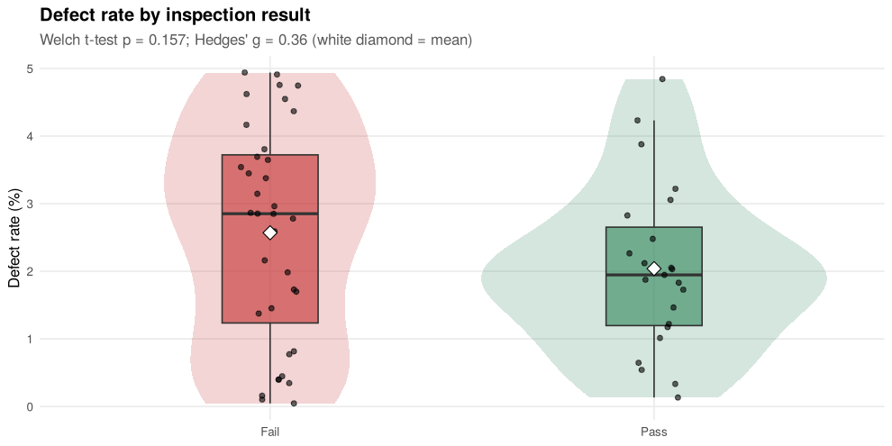

**Result.**

- Failed products have a higher mean defect rate: 2.57% vs. 2.04%, a
  difference of 0.53 percentage points (Welch 95% CI -0.21 to 1.27,
  which includes 0).
- The variances do not differ significantly (Levene p = 0.067,
  borderline), and the Student and Welch tests agree.
- Every test gives p between 0.16 and 0.2. The effect is medium-sized (g
  = 0.36) but **not statistically significant**, because the groups are
  small (36 and 23).
- The 95% CI of g runs from -0.17 to 0.88. The data are compatible with
  no effect and with a large one, so a larger sample is needed.

# 8. Hypothesis tests: more than two groups (ANOVA family)

**Question:** do defect rates differ between the three **shipping
carriers**?

- **One-way ANOVA.** It splits the total variance into a between-groups
  part and a within-groups part. F = MS_between / MS_within. H0: all
  group means are equal.
  - Assumptions: independent observations, normal residuals, and equal
    variances (homoscedasticity).
- **Welch’s ANOVA.** It does not assume equal variances.
- **Kruskal–Wallis test.** The non-parametric alternative, using ranks.
  H0: all groups come from the same distribution.
- **Effect sizes.**
  - **η²** (eta squared) = SS_between / SS_total: the share of variance
    explained by the groups. It is biased upward in small samples.
  - **ω²** (omega squared): a less biased estimate of the same quantity.
    Rough guide: 0.01 is small, 0.06 medium, 0.14 large.
  - **ε²** (epsilon squared, rank-based): the effect size that goes with
    Kruskal–Wallis.
- **Post-hoc tests.** A significant ANOVA says *some* means differ, but
  not which ones. Post-hoc tests compare all pairs while controlling the
  family-wise error rate.
  - **Tukey HSD**: for equal variances.
  - **Games–Howell**: for unequal variances.
  - **Dunn’s test** with Holm correction: follows Kruskal–Wallis.

``` r
sc %>% group_by(shipping_carriers) %>%
  summarise(n = n(), mean = mean(defect_rates), sd = sd(defect_rates),
            median = median(defect_rates)) %>%
  knitr::kable(digits = 3)
```

| shipping_carriers |   n |  mean |    sd | median |
|:------------------|----:|------:|------:|-------:|
| Carrier A         |  28 | 2.740 | 1.423 |  2.878 |
| Carrier B         |  43 | 1.761 | 1.341 |  1.464 |
| Carrier C         |  29 | 2.597 | 1.473 |  2.826 |

``` r
aov1 <- aov(defect_rates ~ shipping_carriers, data = sc)
summary(aov1)
```

    #>                   Df Sum Sq Mean Sq F value Pr(>F)   
    #> shipping_carriers  2   20.4   10.21    5.19 0.0073 **
    #> Residuals         97  191.0    1.97                  
    #> ---
    #> Signif. codes:  0 '***' 0.001 '**' 0.01 '*' 0.05 '.' 0.1 ' ' 1

``` r
# Assumption checks
shapiro_resid <- shapiro.test(residuals(aov1))
levene_1 <- car::leveneTest(defect_rates ~ shipping_carriers, data = sc)
bartlett_1 <- bartlett.test(defect_rates ~ shipping_carriers, data = sc)

welch_1 <- oneway.test(defect_rates ~ shipping_carriers, data = sc, var.equal = FALSE)
kw_1 <- kruskal.test(defect_rates ~ shipping_carriers, data = sc)

anova_tab <- data.frame(
  check_or_test = c("Shapiro-Wilk on residuals", "Levene (equal variances)",
                    "Bartlett (equal variances, assumes normality)", "One-way ANOVA",
                    "Welch ANOVA", "Kruskal-Wallis"),
  statistic = c(shapiro_resid$statistic, levene_1$`F value`[1], bartlett_1$statistic,
                summary(aov1)[[1]]$`F value`[1], welch_1$statistic, kw_1$statistic),
  p_value = c(shapiro_resid$p.value, levene_1$`Pr(>F)`[1], bartlett_1$p.value,
              summary(aov1)[[1]]$`Pr(>F)`[1], welch_1$p.value, kw_1$p.value)
)
knitr::kable(round_df(anova_tab, 4), row.names = FALSE)
```

| check_or_test                                 | statistic | p_value |
|:----------------------------------------------|----------:|--------:|
| Shapiro-Wilk on residuals                     |    0.9753 |  0.0567 |
| Levene (equal variances)                      |    0.1419 |  0.8679 |
| Bartlett (equal variances, assumes normality) |    0.3076 |  0.8575 |
| One-way ANOVA                                 |    5.1854 |  0.0073 |
| Welch ANOVA                                   |    5.2603 |  0.0080 |
| Kruskal-Wallis                                |    9.1347 |  0.0104 |

``` r
eff_anova <- data.frame(
  measure = c("eta squared", "omega squared", "epsilon squared (rank)"),
  estimate = c(effectsize::eta_squared(aov1, partial = FALSE)$Eta2,
               effectsize::omega_squared(aov1, partial = FALSE)$Omega2,
               effectsize::rank_epsilon_squared(defect_rates ~ shipping_carriers, data = sc)$rank_epsilon_squared)
)
knitr::kable(round_df(eff_anova, 3))
```

| measure                | estimate |
|:-----------------------|---------:|
| eta squared            |    0.097 |
| omega squared          |    0.077 |
| epsilon squared (rank) |    0.092 |

``` r
tukey <- TukeyHSD(aov1)
knitr::kable(round_df(as.data.frame(tukey$shipping_carriers), 4))
```

|                     |   diff |     lwr |     upr |  p adj |
|:--------------------|-------:|--------:|--------:|-------:|
| Carrier B-Carrier A | -0.979 | -1.7901 | -0.1679 | 0.0137 |
| Carrier C-Carrier A | -0.143 | -1.0279 |  0.7420 | 0.9218 |
| Carrier C-Carrier B |  0.836 |  0.0335 |  1.6386 | 0.0392 |

``` r
gh <- rstatix::games_howell_test(sc, defect_rates ~ shipping_carriers)
knitr::kable(gh[, c("group1", "group2", "estimate", "conf.low", "conf.high", "p.adj")], digits = 4)
```

| group1    | group2    | estimate | conf.low | conf.high | p.adj |
|:----------|:----------|---------:|---------:|----------:|------:|
| Carrier A | Carrier B |   -0.979 |   -1.793 |   -0.1651 | 0.015 |
| Carrier A | Carrier C |   -0.143 |   -1.067 |    0.7810 | 0.926 |
| Carrier B | Carrier C |    0.836 |    0.014 |    1.6581 | 0.045 |

``` r
dunn <- rstatix::dunn_test(sc, defect_rates ~ shipping_carriers, p.adjust.method = "holm")
knitr::kable(dunn[, c("group1", "group2", "statistic", "p", "p.adj")], digits = 4)
```

| group1    | group2    | statistic |      p |  p.adj |
|:----------|:----------|----------:|-------:|-------:|
| Carrier A | Carrier B |   -2.7087 | 0.0068 | 0.0203 |
| Carrier A | Carrier C |   -0.3884 | 0.6977 | 0.6977 |
| Carrier B | Carrier C |    2.3092 | 0.0209 | 0.0419 |

``` r
means_ci <- sc %>% group_by(shipping_carriers) %>%
  summarise(m = mean(defect_rates), se = std_error(defect_rates), n = n()) %>%
  mutate(lo = m - qt(.975, n - 1) * se, hi = m + qt(.975, n - 1) * se)

p_a <- ggplot(sc, aes(shipping_carriers, defect_rates)) +
  geom_jitter(width = .12, alpha = .35, colour = PALETTE[1]) +
  geom_pointrange(data = means_ci, aes(y = m, ymin = lo, ymax = hi),
                  colour = PALETTE[2], size = .6, linewidth = 1) +
  labs(title = "Defect rate by carrier", subtitle = "Orange: mean with 95% CI",
       x = NULL, y = "Defect rate (%)") + theme_stats()

p_b <- as.data.frame(tukey$shipping_carriers) %>%
  mutate(pair = rownames(.)) %>%
  ggplot(aes(diff, reorder(pair, diff))) +
  geom_vline(xintercept = 0, linetype = 2) +
  geom_pointrange(aes(xmin = lwr, xmax = upr, colour = `p adj` < .05)) +
  scale_colour_manual(values = c(`TRUE` = PALETTE[5], `FALSE` = "grey50"),
                      labels = c(`TRUE` = "p < 0.05", `FALSE` = "n.s."), name = NULL) +
  labs(title = "Tukey HSD: pairwise differences", subtitle = "95% family-wise CI",
       x = "Difference in mean defect rate (pp)", y = NULL) + theme_stats()
p_a + p_b
```

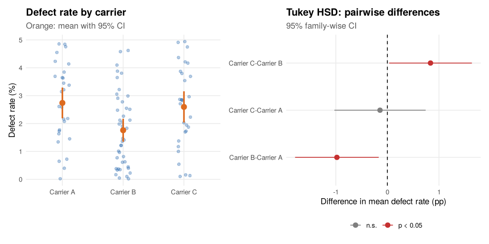

**Result.**

- Carrier B has the lowest mean defect rate. ANOVA (F = 5.19, p =
  0.007), Welch ANOVA (p = 0.008) and Kruskal–Wallis (p = 0.010) all
  reject equal means at α = 0.05.
- The carrier explains about 8% of the variance (ω²), a medium-sized
  effect.
- The assumptions hold, if only just for normality: residual normality p
  = 0.057, Levene p = 0.868.
- All three post-hoc tests agree: **Carrier B differs from both Carrier
  A** (Tukey p = 0.014) **and Carrier C** (Tukey p = 0.039). A and C do
  not differ from each other.
- Business reading: it is worth checking whether Carrier B’s handling
  explains this, or whether a confounder does (for example, which
  products it carries). The multiple regression in Section 11 checks
  this.

## Two-way ANOVA with interaction

**Question:** do total logistics costs depend on product type, transport
mode, or their **combination**?

- An interaction means the effect of one factor depends on the level of
  the other. On an interaction plot, non-parallel lines suggest an
  interaction.
- With unbalanced cells (unequal group sizes), the order of terms
  matters for the default (Type I) sums of squares. We therefore report
  **Type II** SS from `car::Anova`: each main effect is tested after the
  other main effect.

``` r
aov2 <- aov(costs ~ product_type * transportation_modes, data = sc)
car::Anova(aov2, type = 2)
```

    #> Anova Table (Type II tests)
    #> 
    #> Response: costs
    #>                                    Sum Sq Df F value Pr(>F)
    #> product_type                        52203  2    0.39   0.68
    #> transportation_modes               264896  3    1.33   0.27
    #> product_type:transportation_modes  463265  6    1.17   0.33
    #> Residuals                         5830037 88

``` r
effectsize::omega_squared(car::Anova(aov2, type = 2), partial = TRUE)
```

    #> # Effect Size for ANOVA (Type II)
    #> 
    #> Parameter                         | Omega2 (partial) |       95% CI
    #> -------------------------------------------------------------------
    #> product_type                      |             0.00 | [0.00, 1.00]
    #> transportation_modes              |         9.89e-03 | [0.00, 1.00]
    #> product_type:transportation_modes |         9.83e-03 | [0.00, 1.00]
    #> 
    #> - One-sided CIs: upper bound fixed at [1.00].

``` r
table(sc$product_type, sc$transportation_modes)
```

    #>            
    #>             Air Rail Road Sea
    #>   cosmetics   5    9    6   6
    #>   haircare    8   10   12   4
    #>   skincare   13    9   11   7

``` r
sc %>% group_by(transportation_modes, product_type) %>%
  summarise(m = mean(costs), se = std_error(costs), .groups = "drop") %>%
  ggplot(aes(transportation_modes, m, colour = product_type, group = product_type)) +
  geom_line(linewidth = 1, position = position_dodge(.2)) +
  geom_pointrange(aes(ymin = m - se, ymax = m + se), position = position_dodge(.2)) +
  scale_colour_manual(values = PALETTE, name = "Product type") +
  labs(title = "Interaction plot: mean cost by transport mode and product type",
       subtitle = "Error bars = +/- 1 SE. Crossing lines hint at interaction, but the SEs are large",
       x = "Transport mode", y = "Mean cost ($)") +
  theme_stats()
```

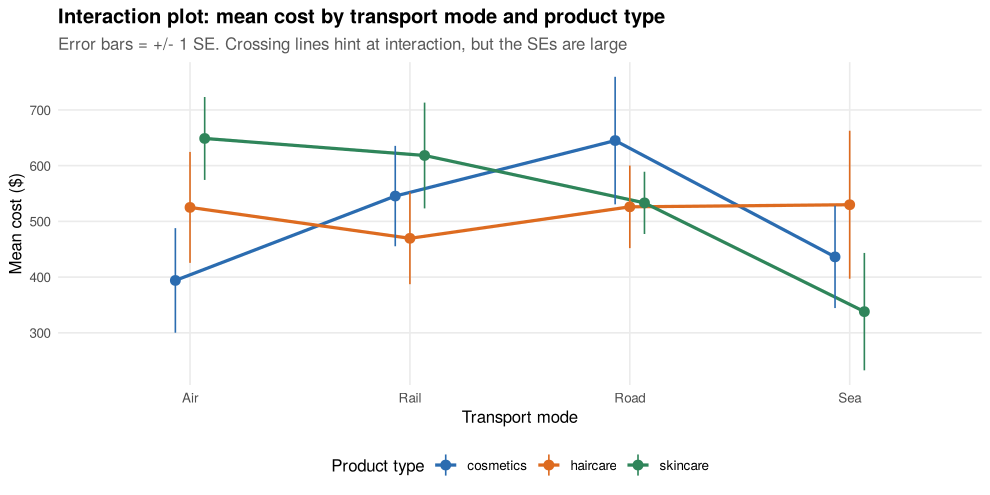

**Result.** Neither main effect nor the interaction is significant. Some
cells have as few as 4 products, so the SE bars are wide and the
crossing lines are consistent with noise. With 12 cells and 100
observations, a two-way ANOVA can only detect large effects.

# 9. Association between categorical variables

**Question:** is the inspection outcome independent of the supplier?

- **Pearson’s chi-square test of independence.**
  - It compares observed cell counts O with the counts expected under
    independence, E = row total × column total / n. χ² = Σ (O − E)² / E.
  - It is valid when the expected counts are large enough (rule of
    thumb: all E ≥ 5, or at least 80% of cells ≥ 5 and none \< 1).
- **Fisher’s exact test.** It computes the exact p-value from the
  hypergeometric distribution, so it is valid for small counts. For
  tables larger than 2×2, the p-value is simulated by Monte Carlo.
- **Cramér’s V** = √(χ² / (n · (min(r, c) − 1))). It measures
  association strength from 0 to 1.
- **Standardised (adjusted) residuals** = (O − E) / SE. They show *which
  cells* drive the result. \|residual\| \> 2 corresponds to roughly p \<
  0.05 for that cell.

``` r
tab_si <- table(sc$supplier_name, sc$inspection_results)
addmargins(tab_si)
```

    #>             
    #>              Fail Pass Pending Sum
    #>   Supplier 1    6   13       8  27
    #>   Supplier 2    8    5       9  22
    #>   Supplier 3    3    2      10  15
    #>   Supplier 4   12    0       6  18
    #>   Supplier 5    7    3       8  18
    #>   Sum          36   23      41 100

``` r
chi <- chisq.test(tab_si)
round(chi$expected, 1)
```

    #>             
    #>              Fail Pass Pending
    #>   Supplier 1  9.7  6.2    11.1
    #>   Supplier 2  7.9  5.1     9.0
    #>   Supplier 3  5.4  3.5     6.2
    #>   Supplier 4  6.5  4.1     7.4
    #>   Supplier 5  6.5  4.1     7.4

``` r
mean(chi$expected >= 5)        # share of cells with expected count >= 5
```

    #> [1] 0.8

``` r
chi
```

    #> 
    #>  Pearson's Chi-squared test
    #> 
    #> data:  tab_si
    #> X-squared = 23, df = 8, p-value = 0.003

``` r
fisher <- fisher.test(tab_si, simulate.p.value = TRUE, B = 20000)
fisher
```

    #> 
    #>  Fisher's Exact Test for Count Data with simulated p-value (based on 20000 replicates)
    #> 
    #> data:  tab_si
    #> p-value = 0.005
    #> alternative hypothesis: two.sided

``` r
cv <- effectsize::cramers_v(tab_si)
cv
```

    #> Cramer's V (adj.) |       95% CI
    #> --------------------------------
    #> 0.28              | [0.00, 1.00]
    #> 
    #> - One-sided CIs: upper bound fixed at [1.00].

``` r
as.data.frame(chi$stdres) %>%
  setNames(c("supplier", "result", "std_residual")) %>%
  ggplot(aes(result, supplier, fill = std_residual)) +
  geom_tile(colour = "white") +
  geom_text(aes(label = sprintf("%+.1f", std_residual)), size = 3.8) +
  geom_text(data = as.data.frame(tab_si) %>% setNames(c("supplier", "result", "n")),
            aes(label = paste0("n=", n), fill = NULL), nudge_y = -.3, size = 2.8, colour = "grey30") +
  scale_fill_gradient2(low = PALETTE[1], mid = "white", high = PALETTE[5], name = "Std. residual") +
  labs(title = "Supplier x inspection result: standardised residuals",
       subtitle = "Red = more than expected under independence; |value| > 2 is notable",
       x = NULL, y = NULL) +
  theme_stats()
```

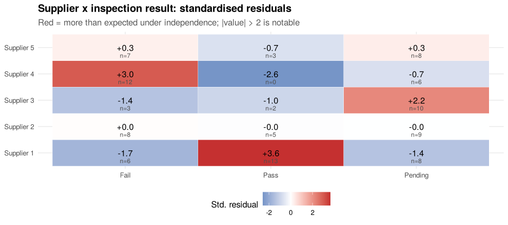

``` r
tab_named <- tab_si
dimnames(tab_named) <- list(Supplier = sub("Supplier ", "S", rownames(tab_si)),
                            Inspection = colnames(tab_si))
vcd::mosaic(tab_named, shade = TRUE, legend = TRUE,
            main = "Mosaic plot (area = count, colour = Pearson residual)")
```

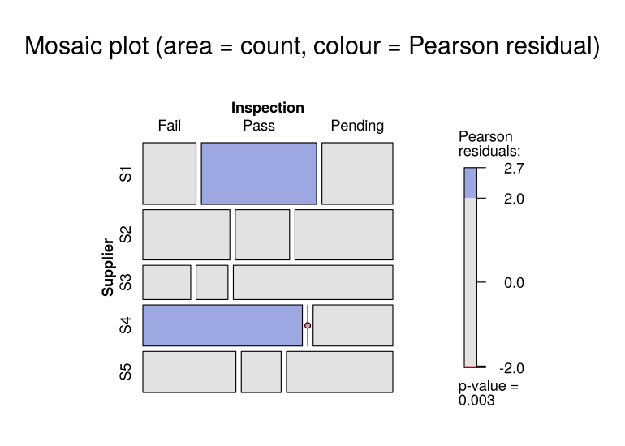

``` r
# Follow-up: failure rate of Supplier 4 vs. all others (2x2 comparison)
s4 <- sc$supplier_name == "Supplier 4"
fails <- c(sum(sc$inspection_results[s4] == "Fail"), sum(sc$inspection_results[!s4] == "Fail"))
ns <- c(sum(s4), sum(!s4))
prop2 <- prop.test(fails, ns)
prop2
```

    #> 
    #>  2-sample test for equality of proportions with continuity correction
    #> 
    #> data:  fails out of ns
    #> X-squared = 7.4, df = 1, p-value = 0.006
    #> alternative hypothesis: two.sided
    #> 95 percent confidence interval:
    #>  0.1011 0.6469
    #> sample estimates:
    #> prop 1 prop 2 
    #> 0.6667 0.2927

``` r
odds_s4 <- fisher.test(table(s4, sc$inspection_results == "Fail"))
odds_s4
```

    #> 
    #>  Fisher's Exact Test for Count Data
    #> 
    #> data:  table(s4, sc$inspection_results == "Fail")
    #> p-value = 0.005
    #> alternative hypothesis: true odds ratio is not equal to 1
    #> 95 percent confidence interval:
    #>   1.451 17.326
    #> sample estimates:
    #> odds ratio 
    #>      4.748

**Result.**

- 80% of the cells have an expected count ≥ 5 (smallest: 3.45). That is
  exactly at the rule-of-thumb limit, so the chi-square approximation (p
  = 0.003) is borderline. Fisher’s exact test is the safer choice here:
  p = 0.005.
- Inspection outcome **depends on the supplier**, with a moderate
  association (Cramér’s V = 0.28).
- The residuals pinpoint two cells:
  - **Supplier 4** has 12 failures out of 18 and *no* passes (residuals
    +3.0 for Fail, -2.6 for Pass).
  - **Supplier 1** has many more passes than expected (+3.6).
- Supplier 4’s failure rate (67%) is far above the rest (29%), with an
  odds ratio of 4.7 (Fisher p = 0.005).
- **This is the most actionable finding in the dataset: audit Supplier
  4.**

# 10. Correlation

| Coefficient    | Measures              | Assumes                                                                                                                           |
|----------------|-----------------------|-----------------------------------------------------------------------------------------------------------------------------------|
| **Pearson r**  | linear association    | both variables roughly normal, no outliers                                                                                        |
| **Spearman ρ** | monotonic association | the Pearson correlation of the ranks, so it is robust                                                                             |
| **Kendall τ**  | monotonic association | based on concordant vs. discordant pairs. Better for small n and ties, and easier to interpret: τ = P(concordant) − P(discordant) |

All three range from −1 to 1. The test of H0: ρ = 0 uses t = r√(n−2) /
√(1−r²). **Correlation does not imply causation**, and with 105 pairs
some will be “significant” by chance alone. That is why we apply the
Benjamini–Hochberg correction.

``` r
cor_s <- psych::corr.test(sc[num_vars], method = "spearman", adjust = "BH")
# corr.test stores raw p-values in the lower triangle and BH-adjusted ones in the
# upper triangle, so we build a symmetric matrix of adjusted p-values.
p_bh_mat <- cor_s$p
p_bh_mat[lower.tri(p_bh_mat)] <- t(p_bh_mat)[lower.tri(p_bh_mat)]
n_sig_bh <- sum(p_bh_mat[upper.tri(p_bh_mat)] < .05)
corrplot::corrplot(cor_s$r, method = "color", type = "lower", order = "hclust",
                   addCoef.col = "grey20", number.cex = .55, tl.col = "black", tl.cex = .7,
                   col = colorRampPalette(c(PALETTE[1], "white", PALETTE[5]))(200),
                   diag = FALSE,
                   title = sprintf("Spearman correlations: %d of 105 significant after BH correction",
                                   n_sig_bh),
                   mar = c(0, 0, 2, 0))
```

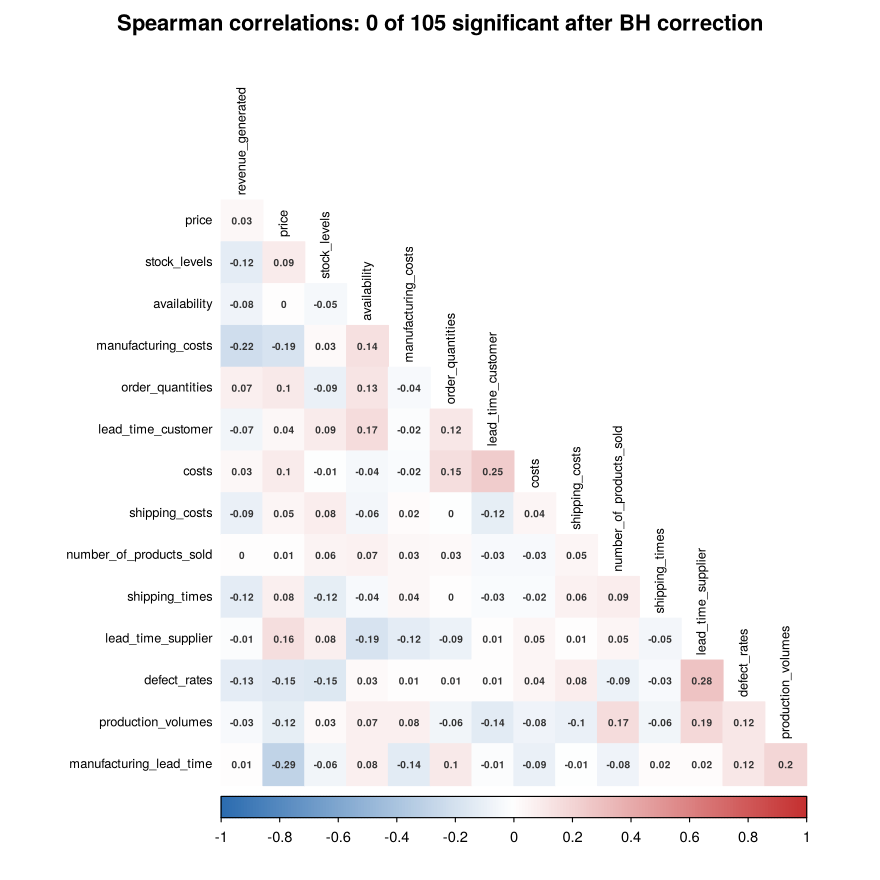

``` r
# Upper-triangle p-values from corr.test are BH-adjusted; lower triangle are raw.
pairs <- which(upper.tri(cor_s$r), arr.ind = TRUE)
pair_tab <- data.frame(
  var1 = rownames(cor_s$r)[pairs[, 1]], var2 = colnames(cor_s$r)[pairs[, 2]],
  spearman = cor_s$r[pairs], p_raw = t(cor_s$p)[pairs], p_bh = cor_s$p[pairs]
) %>% arrange(p_raw)
knitr::kable(round_df(head(pair_tab, 8), 4))
```

| var1               | var2                    | spearman |  p_raw |   p_bh |
|:-------------------|:------------------------|---------:|-------:|-------:|
| price              | manufacturing_lead_time |  -0.2911 | 0.0033 | 0.2474 |
| lead_time_supplier | defect_rates            |   0.2804 | 0.0047 | 0.2474 |
| lead_time_customer | costs                   |   0.2456 | 0.0138 | 0.4824 |
| revenue_generated  | manufacturing_costs     |  -0.2222 | 0.0263 | 0.6898 |
| production_volumes | manufacturing_lead_time |   0.1951 | 0.0518 | 0.8439 |
| lead_time_supplier | production_volumes      |   0.1882 | 0.0608 | 0.8439 |
| price              | manufacturing_costs     |  -0.1874 | 0.0619 | 0.8439 |
| availability       | lead_time_supplier      |  -0.1857 | 0.0643 | 0.8439 |

``` r
cat("Pairs with raw p < 0.05:", sum(pair_tab$p_raw < .05), "of", nrow(pair_tab),
    "| expected by chance:", round(0.05 * nrow(pair_tab), 1),
    "| significant after BH:", sum(pair_tab$p_bh < .05), "\n")
```

    #> Pairs with raw p < 0.05: 4 of 105 | expected by chance: 5.2 | significant after BH: 0

``` r
# Focus pair: supplier lead time vs. defect rate, with all three coefficients
x <- sc$lead_time_supplier; y <- sc$defect_rates
corrs <- data.frame(
  method = c("pearson", "spearman", "kendall"),
  estimate = sapply(c("pearson", "spearman", "kendall"), function(m) cor(x, y, method = m)),
  p_value = sapply(c("pearson", "spearman", "kendall"),
                   function(m) cor.test(x, y, method = m, exact = FALSE)$p.value)
)
pear <- cor.test(x, y)
knitr::kable(round_df(corrs, 4), row.names = FALSE)
```

| method   | estimate | p_value |
|:---------|---------:|--------:|
| pearson  |   0.2971 |  0.0027 |
| spearman |   0.2804 |  0.0047 |
| kendall  |   0.1895 |  0.0060 |

``` r
pear$conf.int
```

    #> [1] 0.1069 0.4663
    #> attr(,"conf.level")
    #> [1] 0.95

``` r
# Partial correlation: lead time vs. defects, controlling for manufacturing lead time
pc <- psych::partial.r(sc[, c("lead_time_supplier", "defect_rates", "manufacturing_lead_time")],
                       c(1, 2), 3)
pc
```

    #> partial correlations 
    #>                    lead_time_supplier defect_rates
    #> lead_time_supplier                1.0          0.3
    #> defect_rates                      0.3          1.0

``` r
ggplot(sc, aes(lead_time_supplier, defect_rates)) +
  geom_point(aes(colour = shipping_carriers), size = 2, alpha = .8) +
  geom_smooth(method = "lm", colour = "black", fill = "grey80") +
  geom_smooth(method = "loess", se = FALSE, colour = PALETTE[2], linetype = 2, span = .9) +
  scale_colour_manual(values = PALETTE, name = "Carrier") +
  labs(title = "Supplier lead time vs. defect rate",
       subtitle = sprintf("Pearson r = %.2f [%.2f, %.2f]; black = OLS fit with 95%% CI, orange = LOESS",
                          pear$estimate, pear$conf.int[1], pear$conf.int[2]),
       x = "Supplier lead time (days)", y = "Defect rate (%)") +
  theme_stats()
```

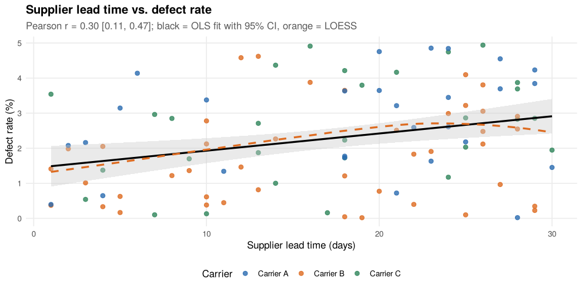

**Result.**

- Out of 105 pairs, 4 have raw p \< 0.05, *fewer* than the 5.2 expected
  by pure chance, and 0 survive the BH correction. Taken as a whole, the
  matrix is consistent with **no real correlations**, which fits the
  simulated-data hypothesis.
- The strongest pair is **supplier lead time vs. defect rate** (Pearson
  r = 0.3, 95% CI 0.11 to 0.47, raw p = 0.003). On its own it looks
  convincing. But it was found by scanning all 105 pairs, so it is a
  **hypothesis generated by the data, not a confirmed effect**. This is
  a classic multiple-comparisons trap.
- It is consistent across all three coefficients, and it barely changes
  when manufacturing lead time is held constant (partial r = 0.3).
- The LOESS curve is close to the straight line, so a linear model is
  adequate.

# 11. Regression

## Simple linear regression

Model: defect_rate = β₀ + β₁ · lead_time + ε, fitted by **ordinary least
squares (OLS)**, which minimises Σ residual².

- **β₁** is the expected change in the defect rate for one more day of
  lead time.
- **R²** is the share of variance explained. For simple regression it
  equals r².
- **Confidence interval vs. prediction interval.**
  - The *confidence* interval covers the **average** defect rate at a
    given lead time.
  - The *prediction* interval covers **a single new product**. It is
    always wider, because it also includes the residual noise σ².

``` r
m1 <- lm(defect_rates ~ lead_time_supplier, data = sc)
summary(m1)
```

    #> 
    #> Call:
    #> lm(formula = defect_rates ~ lead_time_supplier, data = sc)
    #> 
    #> Residuals:
    #>     Min      1Q  Median      3Q     Max 
    #> -2.7919 -1.0665 -0.0434  1.0669  2.6869 
    #> 
    #> Coefficients:
    #>                    Estimate Std. Error t value  Pr(>|t|)    
    #> (Intercept)          1.4389     0.3062    4.70 0.0000085 ***
    #> lead_time_supplier   0.0491     0.0159    3.08    0.0027 ** 
    #> ---
    #> Signif. codes:  0 '***' 0.001 '**' 0.01 '*' 0.05 '.' 0.1 ' ' 1
    #> 
    #> Residual standard error: 1.4 on 98 degrees of freedom
    #> Multiple R-squared:  0.0883, Adjusted R-squared:  0.079 
    #> F-statistic: 9.49 on 1 and 98 DF,  p-value: 0.00268

``` r
confint(m1)
```

    #>                      2.5 % 97.5 %
    #> (Intercept)        0.83131 2.0464
    #> lead_time_supplier 0.01746 0.0807

``` r
new <- data.frame(lead_time_supplier = c(5, 15, 30))
cbind(new,
      round(predict(m1, new, interval = "confidence"), 2),
      round(predict(m1, new, interval = "prediction")[, -1], 2))
```

    #>   lead_time_supplier  fit  lwr  upr   lwr  upr
    #> 1                  5 1.68 1.21 2.16 -1.14 4.51
    #> 2                 15 2.18 1.89 2.46 -0.62 4.97
    #> 3                 30 2.91 2.42 3.41  0.08 5.74

``` r
grid <- data.frame(lead_time_supplier = seq(1, 30, length.out = 100))
bands <- cbind(grid,
               setNames(as.data.frame(predict(m1, grid, interval = "confidence")), c("fit", "cl", "cu")),
               setNames(as.data.frame(predict(m1, grid, interval = "prediction"))[, 2:3], c("pl", "pu")))
ggplot(bands, aes(lead_time_supplier)) +
  geom_ribbon(aes(ymin = pl, ymax = pu), fill = PALETTE[1], alpha = .12) +
  geom_ribbon(aes(ymin = cl, ymax = cu), fill = PALETTE[1], alpha = .35) +
  geom_line(aes(y = fit), colour = PALETTE[1], linewidth = 1) +
  geom_point(data = sc, aes(y = defect_rates), alpha = .6) +
  labs(title = "Confidence band (dark) vs. prediction band (light)",
       subtitle = sprintf("defect = %.2f + %.3f x lead time;  R-squared = %.3f",
                          coef(m1)[1], coef(m1)[2], summary(m1)$r.squared),
       x = "Supplier lead time (days)", y = "Defect rate (%)") +
  theme_stats()
```

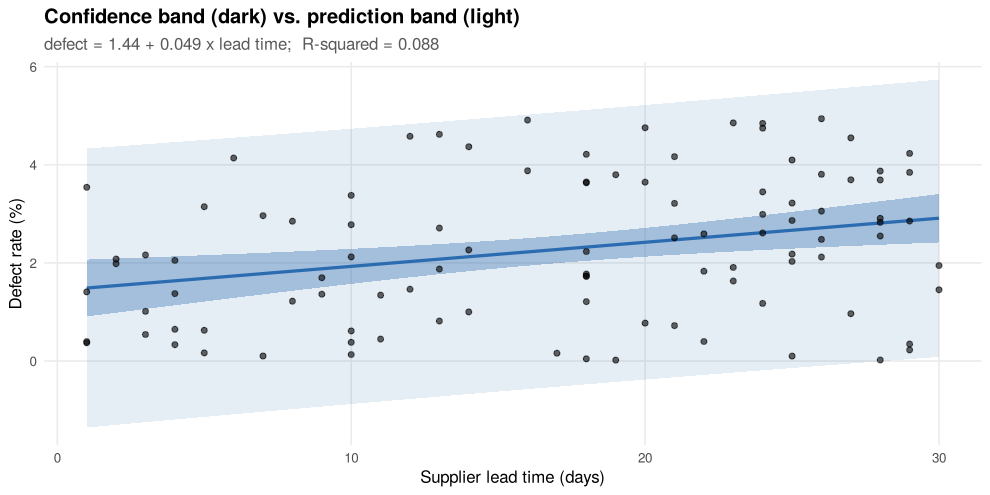

## Multiple linear regression and diagnostics

We add manufacturing lead time, production volume, carrier and supplier
to see whether the lead-time effect survives adjustment and whether the
carrier effect from Section 8 holds.

**What to report and check:**

- **Overall fit.** Adjusted R² penalises extra predictors. The
  **F-test** asks whether the model beats an intercept-only model. **AIC
  and BIC** compare non-nested models, and lower is better.
- **Standardised coefficients (β\*).** Effects in SD units, so
  predictors on different scales can be compared.
- **Linearity and homoscedasticity.**
  - *Residuals vs. fitted* plot: should show no pattern.
  - *Breusch–Pagan test*: H0 is constant variance.
  - *RESET test*: H0 is that the functional form is correct.
- **Normality of residuals.** The Q-Q plot and Shapiro–Wilk test. This
  matters for the CIs and p-values in small samples.
- **Independence.** *Durbin–Watson* test: a value near 2 means no
  autocorrelation. This matters for time-ordered data.
- **Multicollinearity.** *VIF* (variance inflation factor). Above 5–10
  the coefficients become unstable. For factors we use the generalised
  VIF, GVIF^(1/(2·df)), and compare it with √5 ≈ 2.2.
- **Influential points.** *Cook’s distance*: values above 4/n deserve a
  look. *Leverage* (hat values): products with unusual predictor values.
- **Robust (HC3) standard errors.** They stay valid even if the variance
  is not constant.
- **Nested model comparison.** A partial F-test asks whether the extra
  predictors add significant explanatory power.

``` r
m2 <- lm(defect_rates ~ lead_time_supplier + manufacturing_lead_time + production_volumes +
           shipping_carriers + supplier_name, data = sc)
summary(m2)
```

    #> 
    #> Call:
    #> lm(formula = defect_rates ~ lead_time_supplier + manufacturing_lead_time + 
    #>     production_volumes + shipping_carriers + supplier_name, data = sc)
    #> 
    #> Residuals:
    #>     Min      1Q  Median      3Q     Max 
    #> -2.9161 -1.0745 -0.0101  0.9440  3.0706 
    #> 
    #> Coefficients:
    #>                             Estimate Std. Error t value Pr(>|t|)  
    #> (Intercept)                 1.355291   0.538779    2.52    0.014 *
    #> lead_time_supplier          0.042163   0.016449    2.56    0.012 *
    #> manufacturing_lead_time     0.019029   0.015941    1.19    0.236  
    #> production_volumes          0.000176   0.000566    0.31    0.756  
    #> shipping_carriersCarrier B -0.823159   0.343160   -2.40    0.019 *
    #> shipping_carriersCarrier C -0.057860   0.370983   -0.16    0.876  
    #> supplier_nameSupplier 2     0.128304   0.413091    0.31    0.757  
    #> supplier_nameSupplier 3     0.228155   0.455618    0.50    0.618  
    #> supplier_nameSupplier 4     0.315300   0.429063    0.73    0.464  
    #> supplier_nameSupplier 5     0.400529   0.434556    0.92    0.359  
    #> ---
    #> Signif. codes:  0 '***' 0.001 '**' 0.01 '*' 0.05 '.' 0.1 ' ' 1
    #> 
    #> Residual standard error: 1.37 on 90 degrees of freedom
    #> Multiple R-squared:  0.199,  Adjusted R-squared:  0.119 
    #> F-statistic: 2.48 on 9 and 90 DF,  p-value: 0.014

``` r
library(lmtest)
diag_tab <- data.frame(
  diagnostic = c("Shapiro-Wilk (residual normality)", "Breusch-Pagan (homoscedasticity)",
                 "RESET (functional form)", "Durbin-Watson (autocorrelation)"),
  statistic = c(shapiro.test(residuals(m2))$statistic, bptest(m2)$statistic,
                resettest(m2)$statistic, dwtest(m2)$statistic),
  p_value = c(shapiro.test(residuals(m2))$p.value, bptest(m2)$p.value,
              resettest(m2)$p.value, dwtest(m2)$p.value)
)
knitr::kable(round_df(diag_tab, 4), row.names = FALSE)
```

| diagnostic                        | statistic | p_value |
|:----------------------------------|----------:|--------:|
| Shapiro-Wilk (residual normality) |    0.9809 |  0.1563 |
| Breusch-Pagan (homoscedasticity)  |    2.5394 |  0.9798 |
| RESET (functional form)           |    0.1105 |  0.8955 |
| Durbin-Watson (autocorrelation)   |    2.3573 |  0.9626 |

``` r
car::vif(m2)
```

    #>                          GVIF Df GVIF^(1/(2*Df))
    #> lead_time_supplier      1.114  1           1.055
    #> manufacturing_lead_time 1.062  1           1.030
    #> production_volumes      1.165  1           1.079
    #> shipping_carriers       1.103  2           1.025
    #> supplier_name           1.240  4           1.027

``` r
# Robust (heteroskedasticity-consistent, HC3) standard errors
coeftest(m2, vcov = sandwich::vcovHC(m2, type = "HC3"))
```

    #> 
    #> t test of coefficients:
    #> 
    #>                             Estimate Std. Error t value Pr(>|t|)  
    #> (Intercept)                 1.355291   0.537457    2.52    0.013 *
    #> lead_time_supplier          0.042163   0.016397    2.57    0.012 *
    #> manufacturing_lead_time     0.019029   0.017909    1.06    0.291  
    #> production_volumes          0.000176   0.000648    0.27    0.786  
    #> shipping_carriersCarrier B -0.823159   0.363395   -2.27    0.026 *
    #> shipping_carriersCarrier C -0.057860   0.375943   -0.15    0.878  
    #> supplier_nameSupplier 2     0.128304   0.422348    0.30    0.762  
    #> supplier_nameSupplier 3     0.228155   0.451933    0.50    0.615  
    #> supplier_nameSupplier 4     0.315300   0.489850    0.64    0.521  
    #> supplier_nameSupplier 5     0.400529   0.476530    0.84    0.403  
    #> ---
    #> Signif. codes:  0 '***' 0.001 '**' 0.01 '*' 0.05 '.' 0.1 ' ' 1

``` r
# Standardised coefficients
effectsize::standardize_parameters(m2)
```

    #> # Standardization method: refit
    #> 
    #> Parameter                  | Std. Coef. |         95% CI
    #> --------------------------------------------------------
    #> (Intercept)                |       0.12 | [-0.39,  0.64]
    #> lead_time_supplier         |       0.26 | [ 0.06,  0.45]
    #> manufacturing_lead_time    |       0.12 | [-0.08,  0.31]
    #> production_volumes         |       0.03 | [-0.17,  0.23]
    #> shipping_carriersCarrier B |      -0.56 | [-1.03, -0.10]
    #> shipping_carriersCarrier C |      -0.04 | [-0.54,  0.46]
    #> supplier_nameSupplier 2    |       0.09 | [-0.47,  0.65]
    #> supplier_nameSupplier 3    |       0.16 | [-0.46,  0.78]
    #> supplier_nameSupplier 4    |       0.22 | [-0.37,  0.80]
    #> supplier_nameSupplier 5    |       0.27 | [-0.32,  0.86]

``` r
# Nested model comparison: does the full model improve on lead time alone?
anova(m1, m2)
```

    #> Analysis of Variance Table
    #> 
    #> Model 1: defect_rates ~ lead_time_supplier
    #> Model 2: defect_rates ~ lead_time_supplier + manufacturing_lead_time + 
    #>     production_volumes + shipping_carriers + supplier_name
    #>   Res.Df RSS Df Sum of Sq    F Pr(>F)
    #> 1     98 193                         
    #> 2     90 169  8      23.4 1.55   0.15

``` r
data.frame(model = c("m1: lead time", "m2: full"),
           adj_R2 = c(summary(m1)$adj.r.squared, summary(m2)$adj.r.squared),
           AIC = c(AIC(m1), AIC(m2)), BIC = c(BIC(m1), BIC(m2))) %>% knitr::kable(digits = 3)
```

| model         | adj_R2 |   AIC |   BIC |
|:--------------|-------:|------:|------:|
| m1: lead time |  0.079 | 355.4 | 363.2 |
| m2: full      |  0.119 | 358.5 | 387.2 |

``` r
diag_df <- data.frame(fitted = fitted(m2), resid = residuals(m2),
                      std_resid = rstandard(m2), cooks = cooks.distance(m2),
                      leverage = hatvalues(m2), id = seq_len(nrow(sc)))
cook_cut <- 4 / nrow(sc)
d1p <- ggplot(diag_df, aes(fitted, resid)) + geom_point(alpha = .6) +
  geom_hline(yintercept = 0, linetype = 2) + geom_smooth(se = FALSE, colour = PALETTE[2]) +
  labs(title = "Residuals vs fitted", x = "Fitted", y = "Residual") + theme_stats()
d2p <- ggplot(diag_df, aes(sample = std_resid)) + stat_qq(alpha = .6) +
  stat_qq_line(colour = PALETTE[2]) +
  labs(title = "Normal Q-Q of residuals", x = "Theoretical", y = "Standardised residual") + theme_stats()
d3p <- ggplot(diag_df, aes(fitted, sqrt(abs(std_resid)))) + geom_point(alpha = .6) +
  geom_smooth(se = FALSE, colour = PALETTE[2]) +
  labs(title = "Scale-location", x = "Fitted", y = "sqrt(|std. residual|)") + theme_stats()
d4p <- ggplot(diag_df, aes(leverage, std_resid, size = cooks)) +
  geom_point(alpha = .5, colour = ifelse(diag_df$cooks > cook_cut, PALETTE[5], "grey30")) +
  scale_size_continuous(range = c(1, 5), guide = "none") +
  labs(title = "Residuals vs leverage", subtitle = "Size = Cook's distance; red > 4/n",
       x = "Leverage (hat value)", y = "Standardised residual") + theme_stats()
(d1p + d2p) / (d3p + d4p)
```

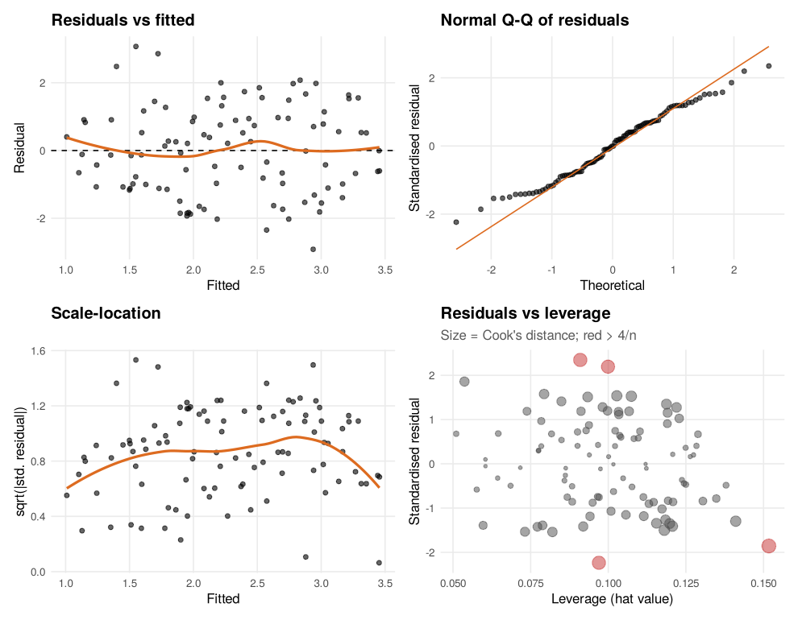

**Result.**

- The full model explains 20% of the variance in defect rates (adjusted
  R² = 0.119, F-test p = 0.014).
- **Supplier lead time remains significant** after adjustment: each
  extra day adds about 0.042 pp. **Carrier B** stays about 0.82 pp lower
  than Carrier A.
- Supplier identity does not predict *defect rates*, even though it
  predicts *inspection failures* (Section 9).
- Every diagnostic is acceptable:
  - residuals are normal and homoscedastic;
  - no misspecification (RESET);
  - no multicollinearity (all GVIF \< 2.2);
  - no observation is overly influential (4 points exceed 4/n, but the
    largest Cook’s distance is 0.06, far below 1);
  - the robust HC3 standard errors give the same conclusions.
- The partial F-test p is 0.151, so the extra predictors do not add
  significant explanatory power as a block. Both AIC and BIC prefer the
  simple model, even though Carrier B is individually significant: a
  reminder to judge models and single coefficients separately.

## Logistic regression

**Question:** what predicts a **failed** inspection (binary outcome)?

- Model: log(p / (1 − p)) = β₀ + β₁x₁ + …, fitted by maximum likelihood.
- exp(β) is the **odds ratio**: the multiplicative change in the odds of
  failing for a one-unit increase in x.
- Overall fit:
  - the **likelihood-ratio test** against the null model;
  - **McFadden pseudo-R²** = 1 − LL_model / LL_null (values of 0.2–0.4
    indicate a good fit);
  - **Tjur’s R²**: the difference in mean predicted probability between
    the two outcome groups.
- Classification quality:
  - the confusion matrix, accuracy, sensitivity and specificity at a 0.5
    cut-off;
  - **ROC-AUC**: the probability that a random failed product gets a
    higher score than a random non-failed one.

``` r
sc$failed <- as.integer(sc$inspection_results == "Fail")
lg <- glm(failed ~ defect_rates + manufacturing_lead_time + supplier_name,
          family = binomial, data = sc)
summary(lg)
```

    #> 
    #> Call:
    #> glm(formula = failed ~ defect_rates + manufacturing_lead_time + 
    #>     supplier_name, family = binomial, data = sc)
    #> 
    #> Coefficients:
    #>                         Estimate Std. Error z value Pr(>|z|)   
    #> (Intercept)              -0.8979     0.6343   -1.42   0.1569   
    #> defect_rates              0.2910     0.1701    1.71   0.0872 . 
    #> manufacturing_lead_time  -0.0833     0.0293   -2.84   0.0045 **
    #> supplier_nameSupplier 2   0.8955     0.6907    1.30   0.1948   
    #> supplier_nameSupplier 3  -0.1408     0.8345   -0.17   0.8660   
    #> supplier_nameSupplier 4   2.2907     0.7591    3.02   0.0025 **
    #> supplier_nameSupplier 5   0.9530     0.7314    1.30   0.1926   
    #> ---
    #> Signif. codes:  0 '***' 0.001 '**' 0.01 '*' 0.05 '.' 0.1 ' ' 1
    #> 
    #> (Dispersion parameter for binomial family taken to be 1)
    #> 
    #>     Null deviance: 130.68  on 99  degrees of freedom
    #> Residual deviance: 108.41  on 93  degrees of freedom
    #> AIC: 122.4
    #> 
    #> Number of Fisher Scoring iterations: 4

``` r
or_tab <- data.frame(odds_ratio = exp(coef(lg)), exp(confint.default(lg)),
                     p_value = summary(lg)$coefficients[, 4])
names(or_tab)[2:3] <- c("ci_low", "ci_high")
knitr::kable(round_df(or_tab, 3))
```

|                         | odds_ratio | ci_low | ci_high | p_value |
|:------------------------|-----------:|-------:|--------:|--------:|
| (Intercept)             |      0.407 |  0.118 |   1.412 |   0.157 |
| defect_rates            |      1.338 |  0.958 |   1.867 |   0.087 |
| manufacturing_lead_time |      0.920 |  0.869 |   0.974 |   0.004 |
| supplier_nameSupplier 2 |      2.449 |  0.632 |   9.480 |   0.195 |
| supplier_nameSupplier 3 |      0.869 |  0.169 |   4.459 |   0.866 |
| supplier_nameSupplier 4 |      9.882 |  2.232 |  43.755 |   0.003 |
| supplier_nameSupplier 5 |      2.593 |  0.618 |  10.876 |   0.193 |

``` r
lg0 <- glm(failed ~ 1, family = binomial, data = sc)
lrt <- anova(lg0, lg, test = "LRT")
lrt
```

    #> Analysis of Deviance Table
    #> 
    #> Model 1: failed ~ 1
    #> Model 2: failed ~ defect_rates + manufacturing_lead_time + supplier_name
    #>   Resid. Df Resid. Dev Df Deviance Pr(>Chi)   
    #> 1        99        131                        
    #> 2        93        108  6     22.3   0.0011 **
    #> ---
    #> Signif. codes:  0 '***' 0.001 '**' 0.01 '*' 0.05 '.' 0.1 ' ' 1

``` r
mcfadden <- 1 - as.numeric(logLik(lg)) / as.numeric(logLik(lg0))
tjur <- performance::r2_tjur(lg)

p_hat <- fitted(lg)
pred <- as.integer(p_hat > 0.5)
cm <- table(predicted = pred, actual = sc$failed)
cm
```

    #>          actual
    #> predicted  0  1
    #>         0 56 21
    #>         1  8 15

``` r
auc <- mean(outer(p_hat[sc$failed == 1], p_hat[sc$failed == 0], ">") +
            0.5 * outer(p_hat[sc$failed == 1], p_hat[sc$failed == 0], "=="))
class_tab <- data.frame(
  metric = c("McFadden R²", "Tjur R²", "Accuracy", "Sensitivity (recall of Fail)",
             "Specificity", "ROC-AUC", "Base rate (always 'not fail')"),
  value = c(mcfadden, tjur, mean(pred == sc$failed), cm["1", "1"] / sum(cm[, "1"]),
            cm["0", "0"] / sum(cm[, "0"]), auc, 1 - mean(sc$failed))
)
knitr::kable(round_df(class_tab, 3))
```

| metric                        | value |
|:------------------------------|------:|
| McFadden R\<U+00B2\>          | 0.170 |
| Tjur R\<U+00B2\>              | 0.208 |
| Accuracy                      | 0.710 |
| Sensitivity (recall of Fail)  | 0.417 |
| Specificity                   | 0.875 |
| ROC-AUC                       | 0.760 |
| Base rate (always ‘not fail’) | 0.640 |

``` r
or_plot <- or_tab[-1, ] %>% mutate(term = rownames(.))
p_or <- ggplot(or_plot, aes(odds_ratio, reorder(term, odds_ratio))) +
  geom_vline(xintercept = 1, linetype = 2) +
  geom_pointrange(aes(xmin = ci_low, xmax = ci_high, colour = p_value < .05)) +
  scale_x_log10() +
  scale_colour_manual(values = c(`TRUE` = PALETTE[5], `FALSE` = "grey50"),
                      labels = c(`TRUE` = "p < 0.05", `FALSE` = "n.s."), name = NULL) +
  labs(title = "Odds ratios for failing inspection", subtitle = "95% Wald CI, log scale",
       x = "Odds ratio", y = NULL) + theme_stats()

roc <- do.call(rbind, lapply(sort(unique(c(0, p_hat, 1))), function(t)
  data.frame(fpr = mean(p_hat[sc$failed == 0] >= t), tpr = mean(p_hat[sc$failed == 1] >= t))))
p_roc <- ggplot(roc, aes(fpr, tpr)) + geom_abline(linetype = 2, colour = "grey50") +
  geom_step(colour = PALETTE[1], linewidth = 1, direction = "vh") +
  labs(title = sprintf("ROC curve (AUC = %.2f)", auc), x = "False positive rate",
       y = "True positive rate") + coord_equal() + theme_stats()
p_or + p_roc + plot_layout(widths = c(1.4, 1))
```

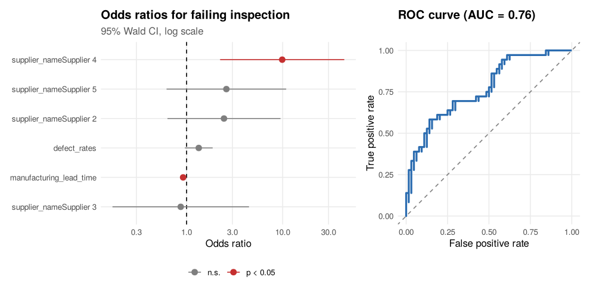

**Result.**

- The model is significantly better than the null model (LR test p =
  0.001, McFadden R² = 0.17, AUC = 0.76). The AUC is in-sample, so it is
  optimistic.
- Holding the other variables constant:
  - **Supplier 4** multiplies the odds of failing by about 9.9 compared
    with Supplier 1. The CI is very wide (2.2 to 43.8) because there are
    only 18 Supplier 4 products, but it clearly excludes 1.
  - Each extra day of **manufacturing lead time** lowers the odds by
    about 8%.
  - Higher **defect rates** raise them, but only at the 10% level.
- The negative effect of lead time is counter-intuitive. One possibility
  is that rushed production fails more often, but with n = 100 this
  should be confirmed on new data before anyone acts on it.

# 12. Statistical power and sample size

- **Power** = P(reject H0 \| H0 is false) = 1 − β. It depends on the
  effect size, the sample size, α, and the test.
- An *a priori* analysis finds the sample size needed for 80% power. A
  *sensitivity* analysis finds the smallest effect detectable with the
  sample we have.
- Low power has two consequences. Non-significant results are
  inconclusive. And the significant results that do appear tend to
  *overestimate* the true effect (the “winner’s curse”).

``` r
library(pwr)
pw <- data.frame(
  question = c(
    "Power of the one-sample t-test for the observed d (Section 6)",
    "Power of the Fail vs Pass comparison for the observed g (Section 7)",
    "n per group needed to detect that g with 80% power",
    "Total n needed to detect a correlation of r = 0.20 with 80% power",
    "Smallest correlation detectable with n = 100 at 80% power",
    "Smallest ANOVA effect f detectable (3 groups of ~33) at 80% power"),
  value = c(
    pwr.t.test(n = 100, d = d1$Cohens_d, type = "one.sample")$power,
    pwr.t2n.test(n1 = 36, n2 = 23, d = g2$Hedges_g)$power,
    ceiling(pwr.t.test(d = g2$Hedges_g, power = .8)$n),
    ceiling(pwr.r.test(r = .2, power = .8)$n),
    pwr.r.test(n = 100, power = .8)$r,
    pwr.anova.test(k = 3, n = 33, power = .8)$f)
)
knitr::kable(round_df(pw, 3))
```

| question                                                            |   value |
|:--------------------------------------------------------------------|--------:|
| Power of the one-sample t-test for the observed d (Section 6)       |   0.467 |
| Power of the Fail vs Pass comparison for the observed g (Section 7) |   0.259 |
| n per group needed to detect that g with 80% power                  | 125.000 |
| Total n needed to detect a correlation of r = 0.20 with 80% power   | 194.000 |
| Smallest correlation detectable with n = 100 at 80% power           |   0.276 |
| Smallest ANOVA effect f detectable (3 groups of ~33) at 80% power   |   0.317 |

``` r
curve_df <- expand.grid(n = seq(10, 300, 5), d = c(.2, .35, .5, .8))
curve_df$power <- mapply(function(n, d) pwr.t.test(n = n, d = d)$power, curve_df$n, curve_df$d)
ggplot(curve_df, aes(n, power, colour = factor(d))) +
  geom_line(linewidth = 1) + geom_hline(yintercept = .8, linetype = 2) +
  scale_colour_manual(values = PALETTE, name = "Cohen's d") +
  scale_y_continuous(labels = percent) +
  labs(title = "Power of a two-sample t-test (alpha = 0.05)",
       subtitle = "Dashed line = conventional 80% target", x = "n per group", y = "Power") +
  theme_stats()
```

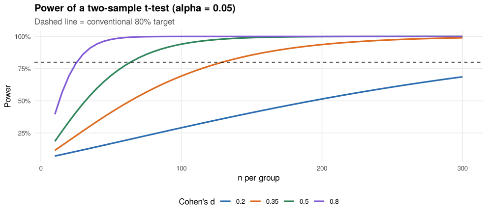

**Result.**

- The Fail vs Pass comparison had only about 26% power. Its
  non-significant p-value is therefore *inconclusive*, not evidence of
  “no difference”. Detecting an effect of that size reliably would need
  about 125 products per group.
- With 100 SKUs, only correlations of \|r\| ≥ 0.28 are reliably
  detectable.

# 13. Multiple testing

Every test at α = 0.05 has a 5% false-positive rate. With m tests, the
chance of at least one false positive is 1 − 0.95^m. For the 12 tests
below that is 46%.

- **Bonferroni**: multiply each p by m. It controls the family-wise
  error rate (FWER) but is very conservative.
- **Holm**: a step-down version of Bonferroni. It is uniformly more
  powerful and still controls the FWER.
- **Benjamini–Hochberg (BH)**: controls the false discovery rate (FDR),
  the expected share of false positives among the rejections. It is the
  standard choice for exploratory analysis.

``` r
mt <- data.frame(
  test = c("Product types equally frequent (GoF)", "Fail rate = 30% (binomial)",
           "Mean defect rate = 2% (t)", "Fail vs Pass defect rate (Welch)",
           "Defect rate by carrier (ANOVA)", "Defect rate by carrier (Kruskal-Wallis)",
           "Cost: product type (2-way)", "Cost: transport mode (2-way)",
           "Cost: interaction (2-way)", "Supplier x inspection (Fisher)",
           "Lead time vs defect rate (Pearson)", "Logistic model vs null (LRT)"),
  p_raw = c(gof$p.value, binom$p.value, t1$p.value, t_welch$p.value,
            summary(aov1)[[1]]$`Pr(>F)`[1], kw_1$p.value,
            car::Anova(aov2, type = 2)$`Pr(>F)`[1:3], fisher$p.value, pear$p.value,
            lrt$`Pr(>Chi)`[2])
)
mt$bonferroni <- p.adjust(mt$p_raw, "bonferroni")
mt$holm <- p.adjust(mt$p_raw, "holm")
mt$bh <- p.adjust(mt$p_raw, "BH")
mt$significant_bh <- mt$bh < .05
knitr::kable(round_df(mt[order(mt$p_raw), ], 4), row.names = FALSE)
```

| test                                    |  p_raw | bonferroni |   holm |     bh | significant_bh |
|:----------------------------------------|-------:|-----------:|-------:|-------:|:---------------|
| Logistic model vs null (LRT)            | 0.0011 |     0.0130 | 0.0130 | 0.0130 | TRUE           |
| Lead time vs defect rate (Pearson)      | 0.0027 |     0.0322 | 0.0295 | 0.0161 | TRUE           |
| Supplier x inspection (Fisher)          | 0.0051 |     0.0618 | 0.0515 | 0.0206 | TRUE           |
| Defect rate by carrier (ANOVA)          | 0.0073 |     0.0870 | 0.0653 | 0.0218 | TRUE           |
| Defect rate by carrier (Kruskal-Wallis) | 0.0104 |     0.1246 | 0.0831 | 0.0249 | TRUE           |
| Mean defect rate = 2% (t)               | 0.0608 |     0.7296 | 0.4256 | 0.1216 | FALSE          |
| Fail vs Pass defect rate (Welch)        | 0.1569 |     1.0000 | 0.9417 | 0.2691 | FALSE          |
| Fail rate = 30% (binomial)              | 0.1916 |     1.0000 | 0.9580 | 0.2874 | FALSE          |
| Product types equally frequent (GoF)    | 0.2276 |     1.0000 | 0.9580 | 0.3035 | FALSE          |
| Cost: transport mode (2-way)            | 0.2689 |     1.0000 | 0.9580 | 0.3226 | FALSE          |
| Cost: interaction (2-way)               | 0.3321 |     1.0000 | 0.9580 | 0.3623 | FALSE          |
| Cost: product type (2-way)              | 0.6756 |     1.0000 | 0.9580 | 0.6756 | FALSE          |

**Result.** After the BH correction, 5 of 12 findings remain
significant: Defect rate by carrier (ANOVA); Defect rate by carrier
(Kruskal-Wallis); Supplier x inspection (Fisher); Lead time vs defect
rate (Pearson); Logistic model vs null (LRT).

The stricter Holm correction keeps only 2: Lead time vs defect rate
(Pearson); Logistic model vs null (LRT). The supplier and carrier
effects sit right at the boundary. They are solid enough to investigate,
but not strong enough to act on without confirmation.

One caveat: the lead time vs. defect rate pair was *chosen* after
looking at the correlation matrix (Section 10). Within this 12-test
family it looks significant, but the honest correction is the one over
all 105 pairs, where it does not survive.

# 14. Summary of findings

| Question                                                | Answer                                                                                                             |
|:--------------------------------------------------------|:-------------------------------------------------------------------------------------------------------------------|
| What do the distributions look like?                    | Symmetric and uniform-like (excess kurtosis -1.1 to -1.4, no outliers): most likely simulated data.                |
| Is revenue concentrated in a few SKUs?                  | No. Gini = 0.27; the top 20% of SKUs earn 32% of revenue.                                                          |
| Is the defect rate above the 2% target?                 | Probably slightly (mean 2.28%), but not significant (p = 0.061; power only 47%).                                   |
| Do failed products have higher defect rates?            | Medium effect (g = 0.36) but p = 0.157; underpowered, so inconclusive.                                             |
| Does the carrier matter for defect rates?               | Carrier B is lower than A and C (omega^2 = 0.08, p = 0.007; survives BH, not Holm).                                |
| Do logistics costs depend on product or transport mode? | No significant main effects or interaction.                                                                        |
| Does inspection outcome depend on the supplier?         | Yes, moderate association: Fisher p = 0.005, Cramer’s V = 0.28. Supplier 4 fails 67% of the time.                  |
| Does lead time relate to defect rates?                  | Possibly (r = 0.30, raw p = 0.003), but it does not survive correction across all 105 pairs: a hypothesis to test. |
| What predicts inspection failure?                       | Supplier 4 (OR about 10) and shorter manufacturing lead time.                                                      |

**Recommended actions:**

1.  Audit **Supplier 4**. It is the largest and most consistent effect:
    it appears in the contingency table, the two-proportion test, and
    the logistic regression.
2.  Review Carrier B’s handling process. It is associated with lower
    defect rates in both the ANOVA and the regression.
3.  Treat the lead time and “rushed production” effects as hypotheses.
    Collect more data before acting on them; the power analysis shows
    how many observations are needed.

``` r
sessionInfo()
```

    #> R version 4.3.3 (2024-02-29)
    #> Platform: x86_64-pc-linux-gnu (64-bit)
    #> Running under: Ubuntu 24.04.5 LTS
    #> 
    #> Matrix products: default
    #> BLAS:   /usr/lib/x86_64-linux-gnu/blas/libblas.so.3.12.0 
    #> LAPACK: /usr/lib/x86_64-linux-gnu/lapack/liblapack.so.3.12.0
    #> 
    #> locale:
    #> [1] C
    #> 
    #> time zone: Europe/Budapest
    #> tzcode source: system (glibc)
    #> 
    #> attached base packages:
    #> [1] stats     graphics  grDevices utils     datasets  methods   base     
    #> 
    #> other attached packages:
    #>  [1] pwr_1.3-0           lmtest_0.9-40       zoo_1.8-12          boot_1.3-30         fitdistrplus_1.1-11
    #>  [6] survival_3.5-8      MASS_7.3-60.0.1     scales_1.3.0        patchwork_1.2.0     ggplot2_3.4.4      
    #> [11] tidyr_1.3.1         dplyr_1.1.4        
    #> 
    #> loaded via a namespace (and not attached):
    #>  [1] gtable_0.3.4       xfun_0.41          bayestestR_0.13.1  coin_1.4-3         corrplot_0.92     
    #>  [6] insight_0.19.8     psych_2.4.1        rstatix_0.7.2      lattice_0.22-5     vctrs_0.6.5       
    #> [11] tools_4.3.3        generics_0.1.3     stats4_4.3.3       parallel_4.3.3     datawizard_0.9.1  
    #> [16] sandwich_3.1-0     tibble_3.2.1       proxy_0.4-27       fansi_1.0.5        highr_0.10        
    #> [21] pkgconfig_2.0.3    Matrix_1.6-5       lifecycle_1.0.4    farver_2.1.1       compiler_4.3.3    
    #> [26] munsell_0.5.0      mnormt_2.1.1       codetools_0.2-19   carData_3.0-5      htmltools_0.5.7   
    #> [31] class_7.3-22       yaml_2.3.8         pillar_1.9.0       car_3.1-2          abind_1.4-5       
    #> [36] multcomp_1.4-25    nlme_3.1-164       tidyselect_1.2.0   digest_0.6.34      nortest_1.0-4     
    #> [41] performance_0.10.8 mvtnorm_1.2-4      purrr_1.0.2        labeling_0.4.3     splines_4.3.3     
    #> [46] fastmap_1.1.1      grid_4.3.3         colorspace_2.1-0   cli_3.6.2          magrittr_2.0.3    
    #> [51] vcd_1.4-12         utf8_1.2.4         broom_1.0.5        TH.data_1.1-2      e1071_1.7-14      
    #> [56] withr_2.5.0        libcoin_1.0-10     backports_1.4.1    estimability_1.4.1 rmarkdown_2.25    
    #> [61] matrixStats_1.2.0  emmeans_1.10.0     modeltools_0.2-23  evaluate_0.23      knitr_1.45        
    #> [66] parameters_0.21.5  mgcv_1.9-1         rlang_1.1.3        xtable_1.8-4       glue_1.7.0        
    #> [71] effectsize_0.8.6   R6_2.5.1
